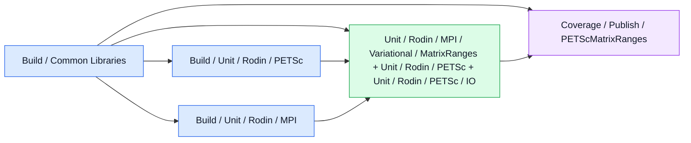

# Configuration graph: `ranges_complex`

Generated by `python3 dev/ci_schedule.py --write`; edit the scheduling sources.

Each node is a declared stage or matrix group within one compatible configuration.
Matrix children and live status appear in the GitHub Actions run graph.
Arrows are the actual `needs` dependencies; this is a scheduling diagram, not a live report.

[Graph index](README.md) · [Architecture](../../workflows/README.md)

Blue: compilation. Green: execution or baseline inventory. Purple: coverage publication.
