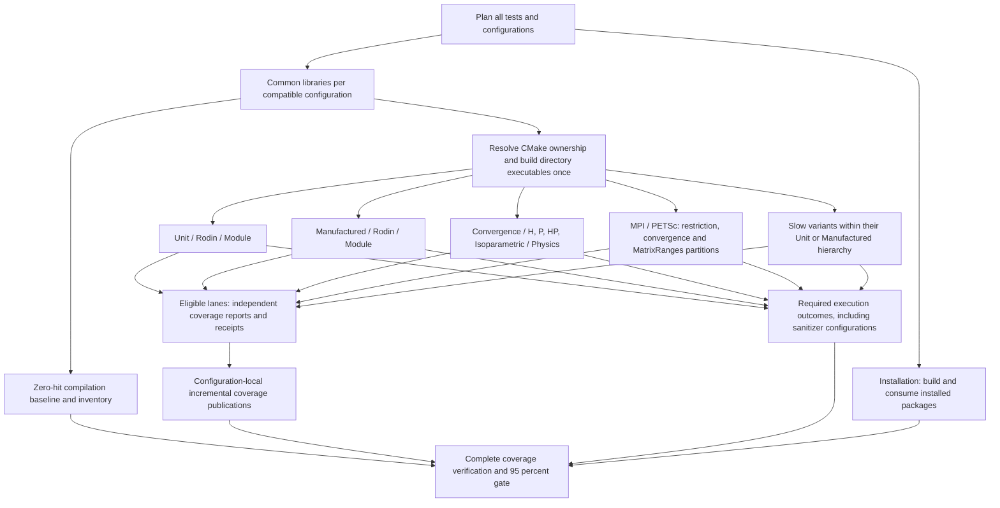

# Workflow architecture and test registration

Rodin separates test registration, scheduling, compilation, execution and
coverage collection. CMake determines which executables exist in a configuration;
the CI planner determines where their tests run. Compatible execution partitions
can share compilation without sharing runtime state.

## Workflow responsibilities

| Workflow | Responsibility |
| --- | --- |
| [Tests.yml](Tests.yml) | Plans the test matrices, schedules grouped and dedicated tests, checks installation, and finalizes coverage. |
| [TestGroup.yml](TestGroup.yml) | Restore directory builds, run the selected regular/Slow invocations, and save independent coverage contributions. |
| `TestConfiguration_*.yml` (for example [native](TestConfiguration_native.yml)) | Generated backend-specific DAGs: compile common libraries, resolve ownership and release each hierarchy independently. |
| [TestCommon.yml](TestCommon.yml) | Common-library compilation recipe used to generate the configuration workflow. |
| Dedicated family workflows (for example [TestConvergence.yml](TestConvergence.yml)) | Generated single-family execution workflows, preserving numerical commands and rank partitions. |
| [TestDirectoryBuild.yml](TestDirectoryBuild.yml) | Compile module/study-type groups using unchanged common objects. |
| [CoveragePublish.yml](CoveragePublish.yml) | Validate every expected lane contribution and submit an incremental production line union to Codecov. |
| [Build.yml](Build.yml) | Independent compilation checks across build types, threading and backend configurations. |
| [Style.yml](Style.yml) | Formatting, house-style, naming and documentation-warning checks, including their tooling regressions. |
| [Documentation.yml](Documentation.yml) | Reusable documentation build and checks; also runs on pull requests. |
| [Benchmarks.yml](Benchmarks.yml) | Runs and publishes performance benchmarks on pushes to the main development branches. |
| [Labeler.yml](Labeler.yml) | Maintains pull-request labels. |
| [copilot-setup-steps.yml](copilot-setup-steps.yml) | Provisions the GitHub coding-agent environment; it is separate from numerical test scheduling. |

The trigger declarations in each workflow define when it runs. The reusable
test, build and publication workflows are called by `Tests.yml`; they do not
start a second independent test campaign. A newer push cancels superseded runs according to
the top-level workflows' concurrency policies.

## Linux dependencies and disk headroom

Linux package provisioning uses
[`apt-dependencies`](../actions/apt-dependencies/action.yml) and
[`ci_environment.py`](../../dev/ci_environment.py). Shared builders, ordinary and
dedicated execution lanes, installation, Build, Documentation and Linux style
dependency steps use this installer. Test commands, configurations, MPI ranks
and coverage producers are independent of the cache.

Before compiler installation, [`prepare-apt`](../actions/prepare-apt/action.yml)
excludes the unused Microsoft Ubuntu feeds on GitHub-hosted Linux runners.
An unavailable feed must not prevent installation of Rodin's Ubuntu packages.
The original definitions are backed up; other sources and signing rules remain
intact. Local machines and self-hosted runners are not changed.

The installer refreshes signed APT indexes, resolves and pins requested packages
and their installation dependencies, then restores `.deb` downloads. Keys include
Ubuntu release, architecture, runner image, requested package set and resolved
versions. Compatible compiler-flag/test-selection variants share downloads. A
prefix restore may supply older archives, but APT must still validate and obtain
the exact pinned packages. Only package archives are cached; installed `/usr`
trees, build outputs, `.gcda` counters and test results are not. Downloads live
under `runner.temp/rodin-apt-archives`, outside the system cache removed by
`apt-get clean`. Locks and partial downloads are not cached. A missing cache
changes performance only, never the tests or their acceptance conditions.

Preinstalled transitive `Depends` and `Pre-Depends` packages are explicitly
resolved to signed repository candidates as well. APT otherwise retains an older
installed library whenever its version satisfies a minimum constraint. Resolution
combines APT's simulated installation with an installed-dependency traversal
seeded by every selected package, including new packages. This reaches libraries
behind not-yet-installed intermediates such as MPI → hwloc → libudev. The pinned
plan grows until stable, retaining earlier exact versions and rejecting solver
conflicts. It excludes recommendations and unused alternative providers.
Candidate policies are read in bounded batches, and the complete plan is logged.
Archive keys include the expanded plan. The shared-build runtime checksum check
remains mandatory: a repository change between jobs still fails closed instead
of executing incompatible binaries.

Shared Linux test and benchmark environments obtain their requested GCC/G++
packages through the same signed APT plan and cached archives. They select the
explicit compiler pair through `CC` and `CXX`, verify matching full versions and
log the runner-provided CMake version. They do not download `setup-cpp` merely
to select tools already present on the hosted image. This avoids an additional
action-archive transfer at every shared producer and consumer while preserving
the configured compiler major version and all numerical test selections. All
dedicated execution lanes request this same environment from the restored build
definition; they do not maintain separate compiler or package setup steps.

Index attempts have a 90-second budget and complete package-download attempts a
300-second budget. GNU `timeout` terminates the privileged APT process group
before fallback. After the runner's original sources, fallback uses the official
Ubuntu archive and then its kernel.org mirror, retaining suites, components,
signing keys and exact resolved versions. Ubuntu `mirror+file:` source indirection
is resolved to the selected fallback transport; otherwise all attempts would
keep consulting the original failing mirror list. Candidate-version discovery
and installation-plan simulation use those same selected source definitions.
Mirror fallback leaves the remaining third-party source definitions unchanged.
Final installation is offline, allows no package removals and has a
900-second budget; configuration failures are not retried as download failures.
Exhausted mirrors fail the job rather than skip its tests.

Disk checks log available space and require **8 GiB of free headroom**. This is
a conservative initial policy, not a measured peak for every hierarchy group.
With sufficient space they do nothing. Otherwise, on GitHub-hosted runners only,
they remove unused .NET, Android, Haskell and CodeQL trees one at a time, logging
each deletion's duration and recovered free space and stopping when sufficient.
They never delete dependency archives or Rodin build/coverage artifacts. If the
allowlisted cleanup cannot supply enough space, the job fails explicitly. Local
and self-hosted machines are never cleaned by this helper. Dependency setup and
artifact restoration recheck headroom, replacing unconditional bulk deletion.

Change package lists in `test-environment/action.yml` for shared environments,
or in `../ci/targeted-lanes.yml` for dedicated lanes, then regenerate dedicated
workflows. Package changes naturally invalidate the resolved-version cache key.
See [the extension guide](../../dev/ci-testing.md) for lane editing and validation.

## Registration and scheduling

1. CMake includes the enabled test directories and registers their targets and
   CTest commands. Optional-backend conditions remain in CMake.
2. [RodinTestManifest.cmake](../../cmake/RodinTestManifest.cmake) exports
   `RodinTestTargets-<configuration>.tsv`: target names, owning directories,
   executable paths, kinds and execution profiles. This configured manifest is
   authoritative; CI does not guess executable names from source filenames.
3. [ci_test_plan.py](../../dev/ci_test_plan.py) scans registration directories to
   generate bounded scheduling matrices. Short sibling modules share parent
   jobs; explicitly listed large components have their own groups. A directory
   group therefore does not necessarily become a separate GitHub job.
4. [ci_tests.py](../../dev/ci_tests.py) selects targets from the manifest and
   discovers tests only for built executables. Its scoped CTest view preserves
   commands, properties, original working directories and MPI rank counts.
5. Each execution lane runs CTest serially. A distributed invocation may use
   several MPI ranks, but separate test invocations do not run concurrently
   within that lane. Independent GitHub jobs can run concurrently.

Use `rodin_discover_tests`, defined in [tests/CMakeLists.txt](../../tests/CMakeLists.txt),
instead of calling `gtest_discover_tests` directly. It forwards GoogleTest
registration options and records the profiles before compilation. Explicit
`add_test` registrations, including MPI commands, are also supported by the
configured runner.

| Test category | Location | Registration and scheduling |
| --- | --- | --- |
| Unit | `tests/unit/Rodin/<Module>/` | `unit` label; directory groups across optimization, threading and sanitizer configurations. |
| Manufactured | `tests/manufactured/Rodin/` | `manufactured` label; directory groups plus the retained baseline backend configurations. |
| Slow | Within the relevant test category | Add `slow` to the category labels; execute in the separate slow profile rather than repeating in ordinary unit/manufactured runs. |
| Convergence | `tests/convergence/{h,p,hp,isoparametric}/` | `convergence` label; native baseline groups or explicitly scheduled dedicated physics/backend partitions. |
| Distributed | Within the corresponding MPI/PETSc module | Explicit MPI CTest commands, category and `distributed` labels, rank counts and appropriate backend initialization. |
| Benchmarks | `tests/benchmarks/Rodin/<Module>/` | Opt-in Google Benchmark executables; separate from numerical CTest gates. |
| Installation | `tests/installation/` | Dedicated installed-package consumption checks. |

Historical selector exceptions are explicit in `ci_tests.py`: selected slow
Geometry cases remain in the unit profile, and native H1 restriction cases use
their dedicated rank partitions. Follow those selectors when extending these
families rather than inferring execution solely from the label table.

The planner writes execution inventories and build contracts for inspection:

- `ci-test-plan.json`: grouped execution and compilation-baseline matrices.
- `ci-convergence-plan.json`: discovered native baseline convergence groups.
- `ci-build-plan.json`: original dedicated compile contracts, retained for auditing.
- `ci-common-plan.json`: common configurations and all original execution requests.
- `ci-build-index.json`: configured ownership and exact execution/build bindings,
  published separately for each compatible configuration.
- `ci-coverage-targets.json`: expected dedicated coverage contributions.

## Shared builds and isolated execution

All unit, manufactured, Slow, convergence, MPI restriction and MatrixRanges
execution lanes use the same build/restore architecture:

The shared-build portion repeats independently for each compatible
configuration. Directory producers follow the physical test hierarchy, such as
`Unit / Rodin / Geometry` and `Manufactured / Rodin / H1`. Each execution
partition waits only for its required producers. The directory, execution,
report and publication nodes represent multiple independent jobs and artifacts;
they do not impose a global barrier before execution or publication.

MPI/PETSc denotes backend-specific partitions within the test categories,
including distributed manufactured and convergence tests; it is not a second
execution of every category. Each distributed invocation preserves its original
MPI ranks. Slow is an orthogonal execution profile within the relevant category:
regular and Slow partitions share compiled executables without repeating their
test selections. Sanitizer and installation checks retain their required
outcomes without contributing coverage. The final gate requires those outcomes
as well as every eligible coverage contribution and the compilation baseline.

The queue initially contains planning, installation checks and common builds.
Directory and execution matrices appear as their prerequisites finish, so the
currently queued job count is not the total test campaign. All 1,354 execution
requests across 46 compatible configurations remain mandatory. The 114 added
partitions separate previously oversized PETSc aggregate selections by context
and complete rate history; they reuse the same builds and retain the same tests.

Display names capitalize hierarchy segments and preserve established spellings:
`Tests / Complex`, `Tests / MPI`, `Tests / PETSc`, `Unit / Rodin / Geometry`,
`Slow`, `MatrixRanges` and `macOS`. Lowercase backend keys and artifact names
remain internal identifiers; they do not determine displayed capitalization.

[ci_build_graph.py](../../dev/ci_build_graph.py) separates common objects,
hierarchy-owned executable artifacts and execution-only coordinates. The complete
compiler/backend/build-type/threading/sanitizer configuration determines
compatibility. Compilation stops at `Unit / Rodin / <Module>`,
`Manufactured / Rodin / <Module>` and `Convergence / H`, `/ P`, `/ HP` or
`/ Isoparametric`. Selected descendants normally share their group's single
artifact; direct root targets retain a separate parent group. The optional
Release build with both sanitizers divides the oversized Variational producer
into numbered parts of at most 24 executables. This configuration selected 133
executables and lost its runner after four hours of compilation. Each part
restores the same common libraries, and dependent lanes wait for the group.
Execution lanes retain their existing partitions. Test enable switches register a superset
without changing production ABI; original configuration-specific
inventories and runtime selectors remain required.

Common compilation follows the CMake dependency closure of requested executables
and explicit baseline libraries; it does not build unrelated library variants.
Common archives include objects for subsequent builders. Tracked input
contents are unchanged; stable source/submodule timestamps prevent later
checkouts invalidating restored objects. Every directory builder checks that
its common objects remained unchanged. Each executable belongs to exactly one
producer for a common configuration. Each of the 46 compatible configurations
progresses independently. Within it, each module/study-type producer is a
distinct dependency job. A lane waits for its combined build group to finish,
including sibling targets in that group. Unrelated hierarchy groups and
configurations do not delay a ready lane. Changes to cut levels require measured
build-time or memory evidence.
Installation checks retain their actual install/consumption builds.

Execution artifacts contain executables, libraries, generated CTest/CMake
metadata, manifests and all zero-hit `.gcno` notes. Execution workspaces exclude
objects and runtime `.gcda` counters. The
[restore action](../actions/test-build/action.yml) checks the source commit,
configuration, architecture, compiler version, archive checksum and runtime
library/MPI-launcher fingerprints. A selection spanning several directories
restores their compatible artifacts. CMake regeneration is suppressed;
execution lanes do not rebuild test targets.

Execution lanes download only the exact archive names in their build index.
Single-artifact steps use the named download action; multi-artifact steps use
[the exact-name downloader](../actions/download-artifacts/action.yml). It uses
GitHub's official artifact client with the current-run runtime credentials,
resolves each name once, then downloads that artifact ID. It never lists every
artifact in the workflow or falls back to `gh run download`. Thus a run with more
than 1,000 artifacts does not silently lose matches or repeatedly consume the
installation REST API quota.

Interrupted or empty transfers retry the same resolved ID up to three times,
with fresh staging on each attempt. A missing name fails immediately. Each
artifact gets its own subdirectory. Restoration still requires `manifest.json`
and `build.tar.gz`; source/configuration, runtime compatibility and archive
SHA256 validation remain mandatory. Incomplete restoration fails the lane.
The downloader's official client dependency is pinned in a lockfile and installed
once per runner in `RUNNER_TEMP`; its JavaScript action uses Node 24.
Client 4.0.0 rejects interrupted streams that could leave 2.3.2 with an unresolved
promise and a successful process exit. The planning job tests both a complete ZIP
transfer and an interrupted transfer against the real pinned client on localhost.
The latter must reject before process exit; mock-client tests also protect exact
name resolution, retry cleanup and mandatory-artifact handling.

Planning and execution bootstrap PyYAML through
`python3 dev/ci_environment.py python`. This reuses the exact importable pinned
version when present. Otherwise it retries bounded pip invocations without the
HTTP cache, including package-index JSON failures, and verifies the installed
version in a fresh Python process. Exhausted retries fail the job.

Regular and Slow variants share executables. MPI ranks, geometries and study
partitions remain execution coordinates with their CMake-defined timeouts and
numerical criteria. A failed producer blocks dependent execution rather than
masquerading as a numerical failure. Artifacts expire after seven days.

## Coverage pooling

Coverage is the union of production-source lines hit by the eligible execution
lanes, not an average of their percentages. Tests and benchmarks may exercise
production code but their own source lines are excluded from the denominator.
Coverage describes compiled code and its instantiated templates.

Coverage counters retain atomic updates for threaded execution. Instrumented
processes can require a different watchdog from ordinary builds: the local
curved cubic-pyramid Stokes rate test uses the existing one-hour high-order
pyramid budget when coverage is enabled. Its refinement hierarchy, numerical
criteria and distributed counterparts are unchanged.

`dev/ci_artifacts.py` derives exact producer artifact names from the same plans
used to schedule execution. A publisher downloads every required contribution
for its family and common configuration, without glob discovery. Finalization
first downloads every planned build index, then every ordinary/targeted receipt,
build receipt and eligible publication. Missing artifacts remain errors; this
download change does not relax receipt/hash checks, compilation inventories,
zero-hit records, the baseline or the final 95% production-line threshold.

- Unsanitized grouped unit/manufactured/slow and dedicated convergence/restriction
  lanes save independent LCOV contributions and receipts. Sanitizer and installation checks
  do not contribute coverage.
- Initial zero-hit reports and compilation baselines preserve the configured
  production libraries and template instantiations even when a runtime partition
  does not execute them. Splitting execution must not shrink that inventory.
- Each restored build starts without runtime counters. Discovery-only counters
  are redirected outside measured coverage; consumers never share `.gcda` files.
- Execution receipts remain distinct even when two lanes use the same compiled
  artifact. Sharing a build does not collapse required coverage contributions.
- [ci_coverage.py](../../dev/ci_coverage.py) checks the current commit, expected
  producers, report digests and compilation inventory before merging. Missing,
  duplicated, stale or tampered contributions cannot silently pass the gate.
- Configuration-local publishers validate all reports in their execution
  families before submitting production line unions. The present plan permits
  at most 64 submissions across the 17 families; empty contributions do not
  create uploads. Each publication records
  every contributing lane and report digest. This keeps service submissions
  below Codecov's default per-commit limit without dropping any contribution.
- `Tests / Coverage / Finalize` verifies all directory builds, unchanged common
  objects, compilation inventories and successful publications. It compares
  the published union against the full raw lane union, enforces the
  **95% production line coverage floor**, and
  finalizes Codecov notifications. It does not rebuild or rerun tests. Historical
  carryforward coverage cannot replace a required current-commit contribution.

## Viewing the job graphs

Open **Actions → Tests → a workflow run** to use GitHub's native live graph.
Job status and dependency edges appear there; click a job for its logs. See
[GitHub’s graph guide](https://docs.github.com/en/actions/how-tos/monitor-workflows/use-the-visualization-graph). The
existing **CMake / CI** job also adds **Test job graphs** to the run summary,
with links to the live run, per-configuration diagrams and workflow sources at
that run's exact commit.

The [generated graph index](../ci/graphs/README.md) provides a smaller diagram
for each backend/instrumentation variant. These Mermaid diagrams are generated
from the same job definitions and `needs` edges as the workflows. They show
stage groups before matrix expansion, with compilation, execution and coverage
publication distinguished by color. They are scheduling diagrams, not live
status or coverage reports. The overview above explains the complete category
and finalization architecture.

Regenerating the workflows also regenerates these diagrams. Preflight rejects
stale output. No extra CI job, third-party rendering service or graph-rendering
dependency is required.

## Editing and diagnosing the graph

The [extension guide](../../dev/ci-testing.md) maps each test or lane change to
its owning files. Ordinary test additions usually need only local CMake
registration. Dedicated selectors and compile recipes require explicit edits;
dynamic build discovery does not invent a new physics or rank partition.
Keep compilation in the reusable producers and runtime selection in the
execution lanes. Update dependency edges and completeness inventories together
when adding a backend or family.

Each compatible configuration has an independent common/directory/execution
graph. Execution jobs depend on their required hierarchy-group producers.
Eleven backend/instrumentation variants declare only their applicable execution
groups; sanitizer variants omit coverage publisher declarations. Dedicated
families each have a single-job reusable workflow. Executable declarations
map to their agreed module/study-type producer; references in test commands
do not create extra producers.
Disabled optional backend directories are excluded from the applicable graph.
Configured binding requires every declared producer and execution matrix to be
nonempty. A missing producer, request or coverage family fails validation;
it is not accepted as a skipped stage. Required downstream stages also remain
required after dependency failures, exposing missing matrices or artifacts as
failures rather than silently skipping work. Explicit workflow cancellation
still stops superseded runs.

The generated DAG is maintained by [ci_schedule.py](../../dev/ci_schedule.py);
dedicated lane sources live in
[targeted-lanes.yml](../ci/targeted-lanes.yml). After editing registrations or
dedicated lanes, run `python3 dev/ci_schedule.py --write`, review the generated
edges, and run the infrastructure guards. Preflight rejects stale generated
workflows, and configured manifest binding rejects missing dependency edges.
Preserve the environment package
recipe and compiler/runtime fingerprints on both sides. Installation and the
independent `Build.yml` checks retain their own compilation because building
and consuming those configurations is the operation under test.

Artifacts provide the following path from a registration to the final report:

| Stage | Evidence and failure diagnosis |
| --- | --- |
| Plan | `ci-test-plan` contains execution matrices, dedicated compile contracts, common configurations and expected coverage partitions. Missing rows indicate scheduling/selector problems. |
| Common compilation | `ci-common-manifest-<mode>-*` records configured targets and resolved requests. Configure errors or missing targets belong to this stage, before numerical execution. |
| Directory planning | `ci-build-index-<configuration-id>` contains `ci-build-index.json`. The index links each execution request to its common configuration and required executable producers. The common job emits bounded matrices for individual hierarchy jobs. |
| Directory compilation | `ci-build-<id>` contains the runtime archive; `ci-built-<id>` records its definition, archive digest and unchanged common objects. A common-object rebuild fails this stage. |
| Restore and execution | The restore action validates the commit, absolute build path, compiler, architecture and runtime libraries. Grouped lanes save `ci-result-<family>-<configuration-id>-<id>`; dedicated lanes save `ci-target-<job>-<configuration-id>-<partition-hash>`. The hash derives from the original full execution definition, independent of its matrix position. Inspect each report and receipt alongside the CTest log. |
| Publication | `ci-publication-<family>-<configuration-id>` contains `CombinedCoverage.info` and `publication.json`, including every source report digest and the successful upload receipt. A missing lane report fails publication rather than producing a partial family. Each publisher waits only for its family within that configuration. |
| Finalization | `coverage-final-summary` records the complete production line result. Missing inventories, builds, contributions or publications fail this gate, as does a raw/published union mismatch or coverage below 95%. |

Build archives are current-run artifacts, not a cross-commit executable cache.
If they expire, rerun the required producer and dependent jobs; an unrelated
run's archive or a historical Codecov report cannot substitute for them.
An upload receipt proves submission, not completion of Codecov processing.
When confirming coverage, check the complete local union and the final
current-commit Codecov report after all family uploads have been processed.

## Benchmark builds and publication

`Benchmarks.yml` is independent of the numerical-test/coverage graph. It runs on
main-branch pushes and manual dispatch. The local and MPI/PETSc configurations
each compile shared Rodin and Google Benchmark libraries once, then build
hierarchical module groups. `BenchmarkConfiguration.yml` owns the common stage;
`BenchmarkGroup.yml` owns a group build and its independent Regular/Slow case
lanes. A lane waits only for its own group, restores its binary and never builds.
MPI and PETSc ranks remain explicit benchmark registrations.

Every enabled benchmark executable must be registered. Discovery determines all
case partitions, and the pooling gate requires every raw report, checksum and
current-commit receipt. Documentation generation runs in parallel using the
same descriptions. Documentation publishes immediately after its own validated
build, reconnecting the new pages to the latest complete benchmark histories.
It does not wait for benchmark builds, execution or pooling. After documentation
publication and successful pooling, **Publish documentation and benchmarks**
updates only complete benchmark histories; it cannot replace newer documentation. Missing or failed
benchmark contributions leave the previous complete results intact. Both
automatic publishers and the manual documentation publisher hold the same `rodin-gh-pages-publication` lock
while writing and deploying. Each publisher uploads the locked `gh-pages`
checkout as its own Pages artifact and uses `actions/deploy-pages` in that
same job. This avoids a second hosted-runner queue for a legacy Pages build;
that queue delayed one deployment by almost eleven hours. A successful branch
push alone is never treated as deployment success. After the deployment action
succeeds, `dev/deploy_pages.py` checks the served `rodin-publication.json` marker
against the exact published `gh-pages` commit, allowing five minutes for CDN
propagation. Documentation and benchmark publication use distinct artifact
names and retain both branch versions and existing complete histories.

Repository setup for these publishers:

- Set **Settings → Pages → Build and deployment → Source** to **GitHub Actions**.
- In **Settings → Environments → Documentation and benchmarks**, permit both `develop` and
  `master` under deployment branches. Preserve the existing `gh-pages` rule if
  other workflows need it. Publication jobs retain this protected environment
  and require `pages: write` and `id-token: write`.

The local workflow repair does not change these repository settings. A legacy
Pages source fails preparation with an actionable diagnostic. The automatic documentation and complete-benchmark publishers, together with
the manual documentation publisher, use the same artifact deployment path.
The unused include-dependency-graph workflow has been removed.

Component histories live
under `benchmark-data/<ref>/`; documentation and its benchmark navigation live
under `docs/<ref>/`. The former aggregate benchmark publisher is retired; its
source cases remain in owning module targets. Benchmark execution is not a
substitute for production coverage or test configurations.

The [benchmark guide](../../tests/benchmarks/README.md) contains the full graph,
paths, measurement definitions and steps for adding a target or execution lane.

Before merging a release, require the stable CI finalization checks in branch
protection, including `Coverage / Finalize`, and inspect the complete current-head
coverage report. A successful partial upload or a previous commit cannot satisfy
that gate. Branch protection is a repository setting, not configured by this
workflow.

## Related documentation

The [test registration guide](../../dev/ci-testing.md) explains how to add tests,
modules and suites, extend scheduling, and inspect selections locally.

## Recovering interrupted runners

`RetryInterruptedJobs.yml` inspects completed, failed **Tests** and
**Benchmarks** push runs on `develop` and `master`. The helper
[`ci_retry.py`](../../dev/ci_retry.py) checks the current branch SHA and job
history, then requests one individual-job rerun only when logs explicitly
identify a runner shutdown or loss of communication. Compilation, numerical,
sanitizer, timeout, checksum and out-of-memory errors are not eligible.
Intentional run cancellations, pull requests, forks and superseded commits
are not retried. Missing logs or API errors fail inspection without requesting
recovery.

Each completion can request one retry. Any prior occurrence of the same job
name in the run exhausts its budget, including manual or dependent reruns.
GitHub also reruns the selected job's dependents. Successful independent jobs
are retained; benchmark artifact uploads replace only their own named artifact
when rerun. Pages snapshots use attempt-specific artifact names to avoid
collisions after an interrupted deployment. Coverage publication, the complete 95% gate and benchmark pooling
retain every mandatory contribution. A recovery request is recorded in the
recovery job summary; a second failure requires investigation. This policy
recovers interruptions but does not establish their cause or remedy resource
exhaustion.

The recovery workflow runs trusted default-branch code with `contents: read`
and `actions: write`, using `GITHUB_TOKEN`; no additional secret is required.
GitHub requires a `workflow_run` listener to exist on the repository's default
branch before it can trigger. A develop-only change therefore remains inactive
until that workflow and its helper reach the default branch. It does not alter
the workflow definitions of older runs and does not create a scheduled monitor.

## Inspectable reports

The Actions run summary links commit-matched scheduling diagrams and job logs.
Execution artifacts contain lane receipts, saved logs and LCOV reports;
`ci-publication-*` contains each validated combined LCOV union and its upload
receipt. `coverage-final-summary` is JSON for the mandatory complete line
coverage result. Codecov provides the browsable source coverage view; no local
LCOV HTML dashboard is currently generated by these workflows.

Benchmark lanes save raw JSON or CSV measurements and validation receipts.
Pooling produces `benchmark-complete`; publication turns complete histories
into the browsable HTML benchmark pages alongside the generated documentation.
The documentation workflow also saves the rendered site as the `documentation`
artifact. These HTML sites are distinct from a test-result dashboard: there is
currently no single generated HTML overview of every test failure.

### Failure summaries and diagnostic artifacts

Benchmark execution lanes save diagnostic context without adding per-lane
summary cards. The lane
captures console output and `/usr/bin/time -v` statistics, including elapsed
time and reported maximum resident set size. These are lane-process statistics,
including restore work, not an aggregate memory measurement across MPI ranks.
Completed CSV cases are saved incrementally; no success receipt is written
until the entire lane passes validation.

On failure, `benchmark-diagnostics-<lane>-attempt-<attempt>` saves available
console output, resource statistics, execution context and partial results.
The summary links this artifact when upload succeeds. Diagnostic artifacts are
not consumed by pooling and cannot satisfy a missing mandatory result. A runner
that disappears may not execute the reporting or upload steps; inspect its
GitHub job log and the separate recovery summary in that case.

The **CI reports and recovery** summary links the source workflow and each
inspected failed job, identifies failed steps, and records requested, deferred,
rejected or exhausted retries with reasons. It also reports jobs that pass on a
later attempt. Inspection/API failures remain failures and are recorded in the
summary when the recovery runner survives. A requested retry is not a passed
job; its eventual status is available in the source workflow's attempts.

### Compact workflow reports

**CI reports and recovery** renders one report after each completed Tests,
or Benchmarks workflow. It runs separately
after completion so interrupted runners cannot prevent reporting. Its summary
links the source workflow and lists registered, started, passed, failed,
cancelled and skipped job counts, with at most 30 failed jobs and
their failed steps; additional failures remain accessible in the source run.

Tests show the saved complete production line counts and the independent
Coverage / Finalize result. A missing, expired, invalid or earlier-attempt
coverage artifact is reported as unavailable. Benchmark reports distinguish
passed registered execution lanes from mandatory campaign completeness.
Publication reports show status and a site link only after successful
publication. Build and Style retain their native checks and annotations.
Failure-only retry decisions follow in the same reporting workflow.

This listener requires deployment to the default branch before activation.
It uses trusted default-branch code; source artifacts are parsed only as JSON,
never executed or extracted into the checkout. No scheduled monitor is created.

### Policies displayed in each report

Each report starts with a visible **Policies** section: recovery runs after
completion, selects at most one interrupted job per attempt, and allows one
retry per job for current develop/master push commits. GitHub reruns dependent
jobs too. Compilation, numerical, sanitizer, timeout, checksum and reported
out-of-memory failures are excluded, as are intentional cancellations and
superseded commits. Missing logs prevent recovery.

The section also states the workflow's completeness requirement: all benchmark
cases and ranks before pooling/publication, or all mandatory test and coverage
contributions with a complete production line result of at least 95%.

## API-backed README badges

`CIBadges.yml` reads actual Actions run conclusions for current develop/master
push commits and writes Shields endpoint JSON to the isolated `ci-badges` branch.
It never redeploys Pages or changes source branches. The README uses these
endpoints for Build, Tests, Benchmarks and Documentation; Codecov is unchanged.

Success is green; failure/timeout red; queued blue; running amber; cancelled and
skipped orange; unknown grey. Older-commit results are unknown for the new head.
Publishers serialize through `rodin-ci-badges`, reread live state rather than
trusting event order, and recheck the source head before each file update.

Initial queue, start and completion events trigger refreshes. GitHub does not
emit `workflow_run: requested` for reruns, so automatic recovery explicitly
requests a badge refresh. A manually requeued run may retain its old badge until
it starts; **CI status badges → Run workflow** provides a manual refresh.
Shields caching and the publisher's own queue also delay visible updates.

Documentation uses the actual `Publish documentation` job, with an explicit
refresh after deployment so it does not wait for benchmark completion. The
listener must reach the default branch before activation. No new secret is
needed: `GITHUB_TOKEN` has read access to Actions and write access only within
the repository. Badge endpoints are public JSON on raw.githubusercontent.com;
missing endpoints remain unavailable until the first publisher initializes them.
