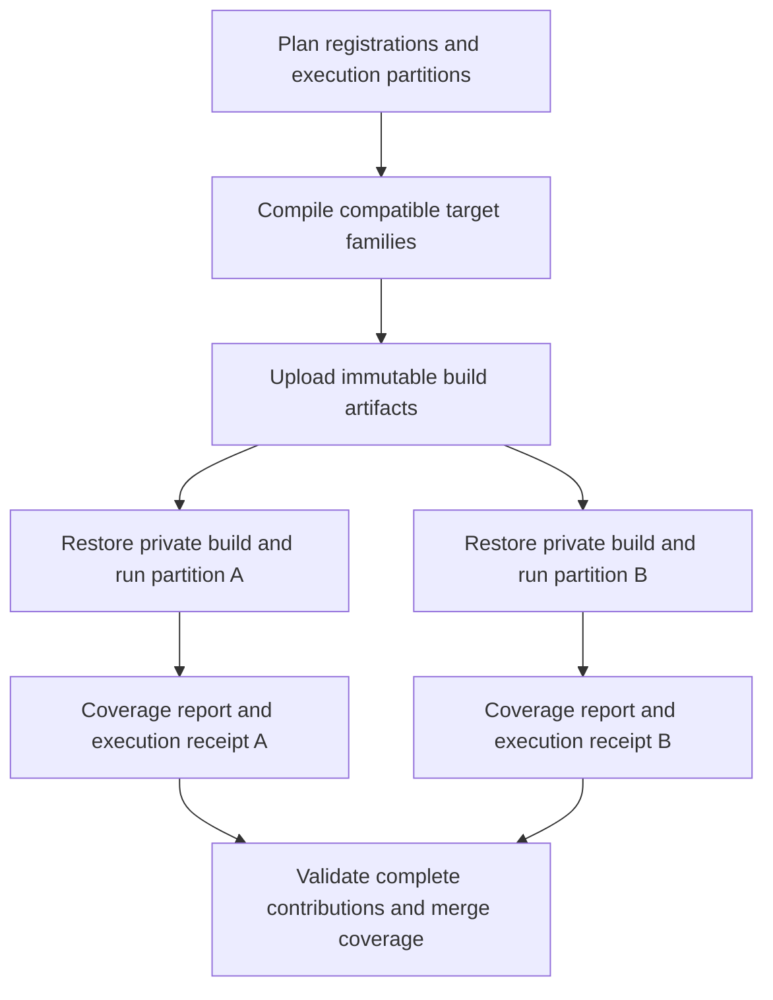

# Workflow architecture and test registration

Rodin separates test registration, scheduling, compilation, execution and
coverage collection. CMake determines which executables exist in a configuration;
the CI planner determines where their tests run. Compatible execution partitions
can share compilation without sharing runtime state.

## Workflow responsibilities

| Workflow | Responsibility |
| --- | --- |
| [Tests.yml](Tests.yml) | Plans the test matrices, schedules grouped and dedicated tests, checks installation, and finalizes coverage. |
| [TestGroup.yml](TestGroup.yml) | Reusable runner for directory groups: configure, build the selected targets, run the selected CTest invocations and publish coverage when enabled. |
| [TestBuild.yml](TestBuild.yml) | Reusable producer of immutable compiled artifacts for compatible dedicated convergence and MPI restriction partitions. |
| [Build.yml](Build.yml) | Independent compilation checks across build types, threading and backend configurations. |
| [Style.yml](Style.yml) | Formatting, house-style, naming and documentation-warning checks, including their tooling regressions. |
| [Documentation.yml](Documentation.yml) | Builds and checks the generated documentation and handles documentation publication. |
| [Benchmarks.yml](Benchmarks.yml) | Runs and publishes performance benchmarks on pushes to the main development branches. |
| [StaticAnalysis.yml](StaticAnalysis.yml) | Generates and publishes the include-dependency graph on pushes to the main development branches. |
| [Labeler.yml](Labeler.yml) | Maintains pull-request labels. |
| [copilot-setup-steps.yml](copilot-setup-steps.yml) | Provisions the GitHub coding-agent environment; it is separate from numerical test scheduling. |

The trigger declarations in each workflow define when it runs. `TestGroup.yml`
and `TestBuild.yml` are called by `Tests.yml`, rather than starting a second
independent test campaign. A newer push cancels superseded runs according to
the top-level workflows' concurrency policies.

## Registration and scheduling

1. CMake includes the enabled test directories and registers their targets and
   CTest commands. Optional-backend conditions remain in CMake.
2. [RodinTestManifest.cmake](../../cmake/RodinTestManifest.cmake) exports
   `RodinTestTargets-<configuration>.tsv`: target names, owning directories,
   executable paths, kinds and execution profiles. This configured manifest is
   authoritative; CI does not guess executable names from source filenames.
3. [ci_test_plan.py](../../dev/ci_test_plan.py) scans registration directories to
   generate bounded scheduling matrices. Short sibling modules share parent
   jobs; explicitly listed large components have their own groups. A directory
   group therefore does not necessarily become a separate GitHub job.
4. [ci_tests.py](../../dev/ci_tests.py) selects targets from the manifest and
   discovers tests only for built executables. Its scoped CTest view preserves
   commands, properties, original working directories and MPI rank counts.
5. Each execution lane runs CTest serially. A distributed invocation may use
   several MPI ranks, but separate test invocations do not run concurrently
   within that lane. Independent GitHub jobs can run concurrently.

Use `rodin_discover_tests`, defined in [tests/CMakeLists.txt](../../tests/CMakeLists.txt),
instead of calling `gtest_discover_tests` directly. It forwards GoogleTest
registration options and records the profiles before compilation. Explicit
`add_test` registrations, including MPI commands, are also supported by the
configured runner.

| Test category | Location | Registration and scheduling |
| --- | --- | --- |
| Unit | `tests/unit/Rodin/<Module>/` | `unit` label; directory groups across optimization, threading and sanitizer configurations. |
| Manufactured | `tests/manufactured/Rodin/` | `manufactured` label; directory groups plus the retained baseline backend configurations. |
| Slow | Within the relevant test category | Add `slow` to the category labels; execute in the separate slow profile rather than repeating in ordinary unit/manufactured runs. |
| Convergence | `tests/convergence/{h,p,hp,isoparametric}/` | `convergence` label; native baseline groups or explicitly scheduled dedicated physics/backend partitions. |
| Distributed | Within the corresponding MPI/PETSc module | Explicit MPI CTest commands, category and `distributed` labels, rank counts and appropriate backend initialization. |
| Benchmarks | `tests/benchmarks/Rodin/<Module>/` | Opt-in Google Benchmark executables; separate from numerical CTest gates. |
| Installation | `tests/installation/` | Dedicated installed-package consumption checks. |

Historical selector exceptions are explicit in `ci_tests.py`: selected slow
Geometry cases remain in the unit profile, and native H1 restriction cases use
their dedicated rank partitions. Follow those selectors when extending these
families rather than inferring execution solely from the label table.

The planner writes four artifacts for inspection:

- `ci-test-plan.json`: grouped execution and compilation-baseline matrices.
- `ci-convergence-plan.json`: discovered native baseline convergence groups.
- `ci-build-plan.json`: deduplicated dedicated build definitions.
- `ci-coverage-targets.json`: expected dedicated coverage contributions.

## Shared builds and isolated execution

Dedicated convergence and native MPI H1 restriction lanes use this flow:



[ci_builds.py](../../dev/ci_builds.py) defines seven bounded build families:
`native`, `restriction`, `petsc_h`, `petsc_degree`, `petsc_curved`,
`petsc_boundary` and `complex`. A build key contains the compiler, runner,
complete CMake configuration and exact target set. Runtime coordinates such as
MPI ranks, geometry and refinement-study selection can reuse that build when
they do not change its definition. This shares compilation per compatible
target family, rather than compiling the entire project once for every backend.
Grouped tests, native baseline convergence, compilation baselines, installation
and standalone MatrixRanges lanes retain their own builds.

Artifacts contain executables, libraries, generated CTest/CMake metadata,
target manifests and zero-hit `.gcno` coverage notes. They exclude `.o` objects
and runtime `.gcda` counters. The [restore action](../actions/test-build/action.yml)
extracts a private copy at the original absolute location and validates the
commit, definition, architecture, compiler version, archive checksum and runtime
library/MPI-launcher fingerprints. Consumers do not compile; CMake regeneration
is suppressed for these artifacts.

A build failure appears in its producer job and skips the dependent execution
family. Restore failures indicate artifact/configuration incompatibility, before
numerical execution. Artifacts expire after seven days; rerun the producer and
dependent execution jobs when an artifact has expired. Each build family has
its own dependency barrier, rather than one global barrier for every test.

## Coverage pooling

Coverage is the union of production-source lines hit by the eligible execution
lanes, not an average of their percentages. Tests and benchmarks may exercise
production code but their own source lines are excluded from the denominator.
Coverage describes compiled code; auditing uninstantiated templates remains a
separate source-review task.

- Unsanitized grouped unit/manufactured/slow and dedicated convergence/restriction
  lanes publish independent LCOV contributions. Sanitizer and installation checks
  do not contribute coverage.
- Initial zero-hit reports and compilation baselines preserve the configured
  production libraries and template instantiations even when a runtime partition
  does not execute them. Splitting execution must not shrink that inventory.
- Each restored build starts without runtime counters. Discovery-only counters
  are redirected outside measured coverage; consumers never share `.gcda` files.
- Execution receipts remain distinct even when two lanes use the same compiled
  artifact. Sharing a build does not collapse required coverage contributions.
- [ci_coverage.py](../../dev/ci_coverage.py) checks the current commit, expected
  producers, report digests and compilation inventory before merging. Missing,
  duplicated, stale or tampered contributions cannot silently pass the gate.
- `Tests / Coverage / Finalize` requires successful producer uploads and shared
  build families, enforces the **95% production line coverage floor**, and
  finalizes Codecov notifications. It does not rebuild or rerun tests. Historical
  carryforward coverage cannot replace a required current-commit contribution.

## Adding tests and modules

### Add a test or GoogleTest suite to an existing executable

Add `TEST`, `TEST_F` or parameterized tests to an already compiled source file.
If adding a source file, also add it to the executable's CMake source list.
GoogleTest discovery registers the new cases after rebuilding; ordinary grouped
CI needs no new workflow entry. A new fixture or GoogleTest suite name does not
by itself require a new executable or GitHub job.

Check existing `TEST_FILTER` expressions and dedicated workflow selectors:
discovery cannot include a case excluded by its registration or execution
filter. Extend the appropriate partition when adding a case outside those
selectors, and verify that it is selected exactly once where intended.

### Add a component executable in an existing module

Follow the nearest module registration. For example, a new Math component can
be registered in [the Math CMake file](../../tests/unit/Rodin/Math/CMakeLists.txt):

```cmake
add_executable(RodinMathNewComponentTest NewComponentTest.cpp)
target_link_libraries(RodinMathNewComponentTest
  PRIVATE GTest::gtest GTest::gtest_main Rodin::Math)
rodin_discover_tests(RodinMathNewComponentTest PROPERTIES LABELS unit)
```

The configured target manifest includes the executable automatically, and the
existing module group builds and discovers it. Do not add an executable-name
list to the workflow. If the component needs its own scheduling group because
of cost, add an explicit component entry and, when needed, an execution-group
mapping in `ci_tests.py`; update the CI guard expectations too.

MPI/PETSc executables with their own initialization must follow their backend's
existing `main` and link pattern rather than blindly adding `gtest_main`.
Use the neighboring explicit MPI `add_test` registrations, preserving launcher
flags, rank counts, timeouts, labels and external-library sanitizer handling.
See [MPI Geometry registration](../../tests/unit/Rodin/MPI/Geometry/CMakeLists.txt).

### Add tests for another module

1. Mirror the production module under `tests/unit/Rodin/<Module>/`; add its
   component sources and `CMakeLists.txt` as above.
2. Include the directory with `add_subdirectory(<Module>)` in its parent test
   CMake file. Apply the same backend/feature condition as the production module.
   Merely creating a directory does not make CMake configure it.
3. Add manufactured regressions under the appropriate space, physics or backend
   directory when assembly/solver behavior needs an end-to-end check. Include
   those directories in their parents as well.
4. Regenerate the plan and inspect the configured target manifest and scoped
   selection. The new module may join a parent group rather than create a job.

Adding a new production library also requires its normal source CMake/export
registration; test discovery does not create library targets. See the
[module architecture](../../doc/agents/architecture.md) and
[extension procedures](../../doc/agents/workflows.md).

### Add manufactured, convergence or slow suites

Use `manufactured` for fixed-mesh numerical checks and `convergence` for
multi-resolution rate studies; preserve the full refinement history in each
study. Follow the existing
[manufactured registration](../../tests/manufactured/Rodin/H1/CMakeLists.txt) and
[convergence guide](../../tests/convergence/README.md).

For ordinary native convergence groups, directory discovery supplies baseline
scheduling. Dedicated native isoparametric and PETSc convergence families use
explicit matrices in `Tests.yml`: adding a new executable/physics family requires
updating its execution selections and `ci_builds.py` target recipe. Adding only
a rank, geometry or study partition can reuse an existing recipe if its compiled
target/configuration is unchanged. Confirm timeout budgets and all required
coverage receipts; do not assume every `convergence` label creates a dedicated
PETSc lane automatically.

For slow tests, label the registration `slow` together with its category. When
splitting one executable's cases between ordinary and slow registrations, use
complementary `TEST_FILTER` expressions so cases are neither repeated nor lost.

### Add an entirely new top-level test category

This is a CI architecture change, unlike adding a GoogleTest suite. Wire the new
category and enable option into CMake, define its registration labels/profile,
extend profile recording and selection in `rodin_discover_tests`/`ci_tests.py`,
and add planner/workflow scheduling. Define its backend configurations, timeout
policy and coverage eligibility. If it contributes coverage, extend the expected
receipt and compilation-inventory contracts and finalizer dependencies. Update
the registration guards and this guide. Prefer the existing categories when
they already express the test's purpose.

## Verify a registration change locally

From the repository root, inspect the generated plan outside the source tree
(Python requires the same pinned PyYAML as the workflow preflight):

```sh
python3 -m pip install PyYAML==6.0.2
mkdir -p /tmp/rodin-ci-plan
python3 dev/ci_test_plan.py --output /tmp/rodin-ci-plan/ci-test-plan.json
```

For an already configured build with the required backend options, build and
inspect a group, then run it. The build may compile in parallel; tests run one
invocation at a time:

```sh
python3 dev/ci_tests.py build --build build --group unit/Rodin/Geometry --profile unit
python3 dev/ci_tests.py list --build build --group unit/Rodin/Geometry --profile unit
python3 dev/ci_tests.py run --build build --group unit/Rodin/Geometry --profile unit
```

Choose the actual group from the generated plan, rather than assuming every
directory is a standalone group. Inspect `build/RodinTestTargets-*.tsv` to confirm
that the expected target is enabled. An optional-backend group can legitimately
have an empty selection in a configuration where its targets are disabled.

For changes to planning, shared compilation or coverage collection, run the CI
infrastructure guards serially:

```sh
python3 -m unittest discover -s dev -p 'test_ci_*.py' -v
```

Some artifact/coverage integration checks require Linux, CMake, a C++ compiler,
LCOV and matching gcov. A skipped tool-dependent check does not validate that
integration. Intentional changes to compilation contracts require reviewing and
updating the pinned guard expectations, rather than weakening them to accept
arbitrary output. Matrix families must remain within GitHub's 256-entry limit;
the planner rejects an oversized family so it can be split explicitly.

See also the [testing rules](../../doc/agents/testing.md),
[benchmark guide](../../tests/benchmarks/README.md) and
[installation checks](../../tests/installation/README.md).
