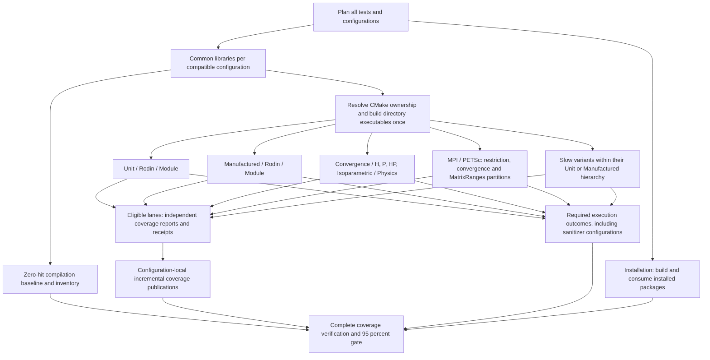

# Workflow architecture and test registration

Rodin separates test registration, scheduling, compilation, execution and
coverage collection. CMake determines which executables exist in a configuration;
the CI planner determines where their tests run. Compatible execution partitions
can share compilation without sharing runtime state.

## Workflow responsibilities

| Workflow | Responsibility |
| --- | --- |
| [Tests.yml](Tests.yml) | Plans the test matrices, schedules grouped and dedicated tests, checks installation, and finalizes coverage. |
| [TestGroup.yml](TestGroup.yml) | Restore directory builds, run the selected regular/Slow invocations, and save independent coverage contributions. |
| `TestConfiguration_*.yml` (for example [native](TestConfiguration_native.yml)) | Generated backend-specific DAGs: compile common libraries, resolve ownership and release each hierarchy independently. |
| [TestCommon.yml](TestCommon.yml) | Common-library compilation recipe used to generate the configuration workflow. |
| Dedicated family workflows (for example [TestConvergence.yml](TestConvergence.yml)) | Generated single-family execution workflows, preserving numerical commands and rank partitions. |
| [TestDirectoryBuild.yml](TestDirectoryBuild.yml) | Compile module/study-type groups using unchanged common objects. |
| [CoveragePublish.yml](CoveragePublish.yml) | Validate every expected lane contribution and submit an incremental production line union to Codecov. |
| [Build.yml](Build.yml) | Independent compilation checks across build types, threading and backend configurations. |
| [Style.yml](Style.yml) | Formatting, house-style, naming and documentation-warning checks, including their tooling regressions. |
| [Documentation.yml](Documentation.yml) | Builds and checks the generated documentation and handles documentation publication. |
| [Benchmarks.yml](Benchmarks.yml) | Runs and publishes performance benchmarks on pushes to the main development branches. |
| [StaticAnalysis.yml](StaticAnalysis.yml) | Generates and publishes the include-dependency graph on pushes to the main development branches. |
| [Labeler.yml](Labeler.yml) | Maintains pull-request labels. |
| [copilot-setup-steps.yml](copilot-setup-steps.yml) | Provisions the GitHub coding-agent environment; it is separate from numerical test scheduling. |

The trigger declarations in each workflow define when it runs. The reusable
test, build and publication workflows are called by `Tests.yml`; they do not
start a second independent test campaign. A newer push cancels superseded runs according to
the top-level workflows' concurrency policies.

## Linux dependencies and disk headroom

Linux package provisioning uses
[`apt-dependencies`](../actions/apt-dependencies/action.yml) and
[`ci_environment.py`](../../dev/ci_environment.py). Shared builders, ordinary and
dedicated execution lanes, installation, Build, Documentation and Linux style
dependency steps use this installer. Test commands, configurations, MPI ranks
and coverage producers are independent of the cache.

The installer refreshes signed APT indexes, resolves and pins requested packages
and their installation dependencies, then restores `.deb` downloads. Keys include
Ubuntu release, architecture, runner image, requested package set and resolved
versions. Compatible compiler-flag/test-selection variants share downloads. A
prefix restore may supply older archives, but APT must still validate and obtain
the exact pinned packages. Only package archives are cached; installed `/usr`
trees, build outputs, `.gcda` counters and test results are not. Downloads live
under `runner.temp/rodin-apt-archives`, outside the system cache removed by
`apt-get clean`. Locks and partial downloads are not cached. A missing cache
changes performance only, never the tests or their acceptance conditions.

Index attempts have a 90-second budget and complete package-download attempts a
300-second budget. GNU `timeout` terminates the privileged APT process group
before fallback. After the runner's original sources, fallback uses the official
Ubuntu archive and then its kernel.org mirror, retaining suites, components,
signing keys and exact resolved versions. Ubuntu `mirror+file:` source indirection
is resolved to the selected fallback transport; otherwise all attempts would
keep consulting the original failing mirror list. Candidate-version discovery
and installation-plan simulation use those same selected source definitions.
Third-party source definitions remain
unchanged. Final installation is offline, allows no package removals and has a
900-second budget; configuration failures are not retried as download failures.
Exhausted mirrors fail the job rather than skip its tests.

Disk checks log available space and require **8 GiB of free headroom**. This is
a conservative initial policy, not a measured peak for every hierarchy group.
With sufficient space they do nothing. Otherwise, on GitHub-hosted runners only,
they remove unused .NET, Android, Haskell and CodeQL trees one at a time, logging
each deletion's duration and recovered free space and stopping when sufficient.
They never delete dependency archives or Rodin build/coverage artifacts. If the
allowlisted cleanup cannot supply enough space, the job fails explicitly. Local
and self-hosted machines are never cleaned by this helper. Dependency setup and
artifact restoration recheck headroom, replacing unconditional bulk deletion.

Change package lists in `test-environment/action.yml` for shared environments,
or in `../ci/targeted-lanes.yml` for dedicated lanes, then regenerate dedicated
workflows. Package changes naturally invalidate the resolved-version cache key.
See [the extension guide](../../dev/ci-testing.md) for lane editing and validation.

## Registration and scheduling

1. CMake includes the enabled test directories and registers their targets and
   CTest commands. Optional-backend conditions remain in CMake.
2. [RodinTestManifest.cmake](../../cmake/RodinTestManifest.cmake) exports
   `RodinTestTargets-<configuration>.tsv`: target names, owning directories,
   executable paths, kinds and execution profiles. This configured manifest is
   authoritative; CI does not guess executable names from source filenames.
3. [ci_test_plan.py](../../dev/ci_test_plan.py) scans registration directories to
   generate bounded scheduling matrices. Short sibling modules share parent
   jobs; explicitly listed large components have their own groups. A directory
   group therefore does not necessarily become a separate GitHub job.
4. [ci_tests.py](../../dev/ci_tests.py) selects targets from the manifest and
   discovers tests only for built executables. Its scoped CTest view preserves
   commands, properties, original working directories and MPI rank counts.
5. Each execution lane runs CTest serially. A distributed invocation may use
   several MPI ranks, but separate test invocations do not run concurrently
   within that lane. Independent GitHub jobs can run concurrently.

Use `rodin_discover_tests`, defined in [tests/CMakeLists.txt](../../tests/CMakeLists.txt),
instead of calling `gtest_discover_tests` directly. It forwards GoogleTest
registration options and records the profiles before compilation. Explicit
`add_test` registrations, including MPI commands, are also supported by the
configured runner.

| Test category | Location | Registration and scheduling |
| --- | --- | --- |
| Unit | `tests/unit/Rodin/<Module>/` | `unit` label; directory groups across optimization, threading and sanitizer configurations. |
| Manufactured | `tests/manufactured/Rodin/` | `manufactured` label; directory groups plus the retained baseline backend configurations. |
| Slow | Within the relevant test category | Add `slow` to the category labels; execute in the separate slow profile rather than repeating in ordinary unit/manufactured runs. |
| Convergence | `tests/convergence/{h,p,hp,isoparametric}/` | `convergence` label; native baseline groups or explicitly scheduled dedicated physics/backend partitions. |
| Distributed | Within the corresponding MPI/PETSc module | Explicit MPI CTest commands, category and `distributed` labels, rank counts and appropriate backend initialization. |
| Benchmarks | `tests/benchmarks/Rodin/<Module>/` | Opt-in Google Benchmark executables; separate from numerical CTest gates. |
| Installation | `tests/installation/` | Dedicated installed-package consumption checks. |

Historical selector exceptions are explicit in `ci_tests.py`: selected slow
Geometry cases remain in the unit profile, and native H1 restriction cases use
their dedicated rank partitions. Follow those selectors when extending these
families rather than inferring execution solely from the label table.

The planner writes execution inventories and build contracts for inspection:

- `ci-test-plan.json`: grouped execution and compilation-baseline matrices.
- `ci-convergence-plan.json`: discovered native baseline convergence groups.
- `ci-build-plan.json`: original dedicated compile contracts, retained for auditing.
- `ci-common-plan.json`: common configurations and all original execution requests.
- `ci-build-index.json`: configured ownership and exact execution/build bindings,
  published separately for each compatible configuration.
- `ci-coverage-targets.json`: expected dedicated coverage contributions.

## Shared builds and isolated execution

All unit, manufactured, Slow, convergence, MPI restriction and MatrixRanges
execution lanes use the same build/restore architecture:

The shared-build portion repeats independently for each compatible
configuration. Directory producers follow the physical test hierarchy, such as
`Unit / Rodin / Geometry` and `Manufactured / Rodin / H1`. Each execution
partition waits only for its required producers. The directory, execution,
report and publication nodes represent multiple independent jobs and artifacts;
they do not impose a global barrier before execution or publication.

MPI/PETSc denotes backend-specific partitions within the test categories,
including distributed manufactured and convergence tests; it is not a second
execution of every category. Each distributed invocation preserves its original
MPI ranks. Slow is an orthogonal execution profile within the relevant category:
regular and Slow partitions share compiled executables without repeating their
test selections. Sanitizer and installation checks retain their required
outcomes without contributing coverage. The final gate requires those outcomes
as well as every eligible coverage contribution and the compilation baseline.

The queue initially contains planning, installation checks and common builds.
Directory and execution matrices appear as their prerequisites finish, so the
currently queued job count is not the total test campaign. All 1,354 execution
requests across 46 compatible configurations remain mandatory. The 114 added
partitions separate previously oversized PETSc aggregate selections by context
and complete rate history; they reuse the same builds and retain the same tests.

Display names capitalize hierarchy segments and preserve established spellings:
`Tests / Complex`, `Tests / MPI`, `Tests / PETSc`, `Unit / Rodin / Geometry`,
`Slow`, `MatrixRanges` and `macOS`. Lowercase backend keys and artifact names
remain internal identifiers; they do not determine displayed capitalization.

[ci_build_graph.py](../../dev/ci_build_graph.py) separates common objects,
hierarchy-owned executable artifacts and execution-only coordinates. The complete
compiler/backend/build-type/threading/sanitizer configuration determines
compatibility. Compilation stops at `Unit / Rodin / <Module>`,
`Manufactured / Rodin / <Module>` and `Convergence / H`, `/ P`, `/ HP` or
`/ Isoparametric`. Selected descendants share their group's single artifact;
direct root targets retain a separate parent group. There are no automatic
numbered subdivisions or component-specific compilation jobs. Execution lanes
retain their existing partitions. Test enable switches register a superset
without changing production ABI; original configuration-specific
inventories and runtime selectors remain required.

Common compilation follows the CMake dependency closure of requested executables
and explicit baseline libraries; it does not build unrelated library variants.
Common archives include objects for subsequent builders. Tracked input
contents are unchanged; stable source/submodule timestamps prevent later
checkouts invalidating restored objects. Every directory builder checks that
its common objects remained unchanged. Each executable belongs to exactly one
producer for a common configuration. Each of the 46 compatible configurations
progresses independently. Within it, each module/study-type producer is a
distinct dependency job. A lane waits for its combined build group to finish,
including sibling targets in that group. Unrelated hierarchy groups and
configurations do not delay a ready lane. Changes to cut levels require measured
build-time or memory evidence.
Installation checks retain their actual install/consumption builds.

Execution artifacts contain executables, libraries, generated CTest/CMake
metadata, manifests and all zero-hit `.gcno` notes. Execution workspaces exclude
objects and runtime `.gcda` counters. The
[restore action](../actions/test-build/action.yml) checks the source commit,
configuration, architecture, compiler version, archive checksum and runtime
library/MPI-launcher fingerprints. A selection spanning several directories
restores their compatible artifacts. CMake regeneration is suppressed;
execution lanes do not rebuild test targets.

Execution lanes pre-download only their indexed archives. Restoration accepts
that download only when both `manifest.json` and `build.tar.gz` exist. An
incomplete download triggers `gh run download` for that exact archive with the
workflow's read-only Actions token: at most three fresh attempts, each bounded
to two minutes. A downloader success alone is insufficient. Source/configuration
and SHA256 validation remain mandatory; failed recovery fails the lane instead
of skipping its tests.

Regular and Slow variants share executables. MPI ranks, geometries and study
partitions remain execution coordinates with their original timeouts and
numerical criteria. A failed producer blocks dependent execution rather than
masquerading as a numerical failure. Artifacts expire after seven days.

## Coverage pooling

Coverage is the union of production-source lines hit by the eligible execution
lanes, not an average of their percentages. Tests and benchmarks may exercise
production code but their own source lines are excluded from the denominator.
Coverage describes compiled code and its instantiated templates.

- Unsanitized grouped unit/manufactured/slow and dedicated convergence/restriction
  lanes save independent LCOV contributions and receipts. Sanitizer and installation checks
  do not contribute coverage.
- Initial zero-hit reports and compilation baselines preserve the configured
  production libraries and template instantiations even when a runtime partition
  does not execute them. Splitting execution must not shrink that inventory.
- Each restored build starts without runtime counters. Discovery-only counters
  are redirected outside measured coverage; consumers never share `.gcda` files.
- Execution receipts remain distinct even when two lanes use the same compiled
  artifact. Sharing a build does not collapse required coverage contributions.
- [ci_coverage.py](../../dev/ci_coverage.py) checks the current commit, expected
  producers, report digests and compilation inventory before merging. Missing,
  duplicated, stale or tampered contributions cannot silently pass the gate.
- Configuration-local publishers validate all reports in their execution
  families before submitting production line unions. The present plan permits
  at most 64 submissions across the 17 families; empty contributions do not
  create uploads. Each publication records
  every contributing lane and report digest. This keeps service submissions
  below Codecov's default per-commit limit without dropping any contribution.
- `Tests / Coverage / Finalize` verifies all directory builds, unchanged common
  objects, compilation inventories and successful publications. It compares
  the published union against the full raw lane union, enforces the
  **95% production line coverage floor**, and
  finalizes Codecov notifications. It does not rebuild or rerun tests. Historical
  carryforward coverage cannot replace a required current-commit contribution.

## Viewing the job graphs

Open **Actions → Tests → a workflow run** to use GitHub's native live graph.
Job status and dependency edges appear there; click a job for its logs. See
[GitHub’s graph guide](https://docs.github.com/en/actions/how-tos/monitor-workflows/use-the-visualization-graph). The
existing **CMake / CI** job also adds **Test job graphs** to the run summary,
with links to the live run, per-configuration diagrams and workflow sources at
that run's exact commit.

The [generated graph index](../ci/graphs/README.md) provides a smaller diagram
for each backend/instrumentation variant. These Mermaid diagrams are generated
from the same job definitions and `needs` edges as the workflows. They show
stage groups before matrix expansion, with compilation, execution and coverage
publication distinguished by color. They are scheduling diagrams, not live
status or coverage reports. The overview above explains the complete category
and finalization architecture.

Regenerating the workflows also regenerates these diagrams. Preflight rejects
stale output. No extra CI job, third-party rendering service or graph-rendering
dependency is required.

## Editing and diagnosing the graph

The [extension guide](../../dev/ci-testing.md) maps each test or lane change to
its owning files. Ordinary test additions usually need only local CMake
registration. Dedicated selectors and compile recipes require explicit edits;
dynamic build discovery does not invent a new physics or rank partition.
Keep compilation in the reusable producers and runtime selection in the
execution lanes. Update dependency edges and completeness inventories together
when adding a backend or family.

Each compatible configuration has an independent common/directory/execution
graph. Execution jobs depend on their required hierarchy-group producers.
Eleven backend/instrumentation variants declare only their applicable execution
groups; sanitizer variants omit coverage publisher declarations. Dedicated
families each have a single-job reusable workflow. Executable declarations
map to their agreed module/study-type producer; references in test commands
do not create extra producers.
Disabled optional backend directories are excluded from the applicable graph.
Configured binding requires every declared producer and execution matrix to be
nonempty. A missing producer, request or coverage family fails validation;
it is not accepted as a skipped stage. Required downstream stages also remain
required after dependency failures, exposing missing matrices or artifacts as
failures rather than silently skipping work. Explicit workflow cancellation
still stops superseded runs.

The generated DAG is maintained by [ci_schedule.py](../../dev/ci_schedule.py);
dedicated lane sources live in
[targeted-lanes.yml](../ci/targeted-lanes.yml). After editing registrations or
dedicated lanes, run `python3 dev/ci_schedule.py --write`, review the generated
edges, and run the infrastructure guards. Preflight rejects stale generated
workflows, and configured manifest binding rejects missing dependency edges.
Preserve the environment package
recipe and compiler/runtime fingerprints on both sides. Installation and the
independent `Build.yml` checks retain their own compilation because building
and consuming those configurations is the operation under test.

Artifacts provide the following path from a registration to the final report:

| Stage | Evidence and failure diagnosis |
| --- | --- |
| Plan | `ci-test-plan` contains execution matrices, dedicated compile contracts, common configurations and expected coverage partitions. Missing rows indicate scheduling/selector problems. |
| Common compilation | `ci-common-manifest-<mode>-*` records configured targets and resolved requests. Configure errors or missing targets belong to this stage, before numerical execution. |
| Directory planning | `ci-build-index-<configuration-id>` contains `ci-build-index.json`. The index links each execution request to its common configuration and required executable producers. The common job emits bounded matrices for individual hierarchy jobs. |
| Directory compilation | `ci-build-<id>` contains the runtime archive; `ci-built-<id>` records its definition, archive digest and unchanged common objects. A common-object rebuild fails this stage. |
| Restore and execution | The restore action validates the commit, absolute build path, compiler, architecture and runtime libraries. Grouped lanes save `ci-result-<family>-<configuration-id>-<id>`; dedicated lanes save `ci-target-<job>-<configuration-id>-<partition-hash>`. The hash derives from the original full execution definition, independent of its matrix position. Inspect each report and receipt alongside the CTest log. |
| Publication | `ci-publication-<family>-<configuration-id>` contains `CombinedCoverage.info` and `publication.json`, including every source report digest and the successful upload receipt. A missing lane report fails publication rather than producing a partial family. Each publisher waits only for its family within that configuration. |
| Finalization | `coverage-final-summary` records the complete production line result. Missing inventories, builds, contributions or publications fail this gate, as does a raw/published union mismatch or coverage below 95%. |

Build archives are current-run artifacts, not a cross-commit executable cache.
If they expire, rerun the required producer and dependent jobs; an unrelated
run's archive or a historical Codecov report cannot substitute for them.
An upload receipt proves submission, not completion of Codecov processing.
When confirming coverage, check the complete local union and the final
current-commit Codecov report after all family uploads have been processed.

## Related documentation

The [test registration guide](../../dev/ci-testing.md) explains how to add tests,
modules and suites, extend scheduling, and inspect selections locally.
