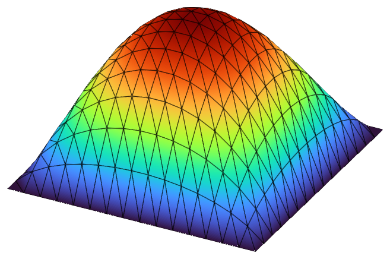

<p align="center">
  <a href="https://cbritopacheco.github.io/rodin/docs/refs/heads/master/">
    <picture>
      <source media="(prefers-color-scheme: dark)" srcset="brand/logos/horizontal-white.svg">
      <source media="(prefers-color-scheme: light)" srcset="brand/logos/horizontal-color.svg">
      
    </picture>
  </a>
</p>

<p align="center"><strong>A modern C++ FEM library for shape and topology optimization.</strong></p>

<p align="center">
  <a href="LICENSE"></a>
  <a href="https://www.buymeacoffee.com/cbritopacheco"></a>
</p>

Rodin is a modular C++20 finite element framework for solving partial differential equations and developing shape and topology optimization algorithms. Its compositional form language connects mathematical formulations to C++ code, with mesh refinement, remeshing and solver backends available through independent modules.

It is named after the French sculptor Auguste Rodin, considered the founder of modern sculpture.

Contributions, issue reports and documentation improvements are welcome.

## Getting started

The [getting started
  guide](https://cbritopacheco.github.io/rodin/docs/refs/heads/master/guides-getting-started-installation.html) covers installation, a first solve and the
  main library objects:

- **[Installation and setup](https://cbritopacheco.github.io/rodin/docs/refs/heads/master/guides-getting-started-installation.html)** - Platform-specific installation instructions and verification
- **[First steps](https://cbritopacheco.github.io/rodin/docs/refs/heads/master/guides-getting-started-first-steps.html)** - Project structure and a first Rodin program
- **[A first problem](https://cbritopacheco.github.io/rodin/docs/refs/heads/master/guides-getting-started-first-problem.html)** - Complete walkthrough solving the Poisson equation
- **[Core concepts](https://cbritopacheco.github.io/rodin/docs/refs/heads/master/guides-getting-started-core-concepts.html)** - Meshes, finite element spaces and variational formulations

## Status

| Branch      |  Build   | Tests | Code Coverage | Benchmarks | Documentation |
|:-----------:|:--------:|:-----:|:-------------:|:----------:|:-------------:|
| master      | [](https://github.com/cbritopacheco/rodin/actions/workflows/Build.yml?query=branch%3Amaster) | [](https://github.com/cbritopacheco/rodin/actions/workflows/Tests.yml?query=branch%3Amaster) | [](https://app.codecov.io/gh/cbritopacheco/rodin/tree/master)  | [](https://cbritopacheco.github.io/rodin/docs/refs/heads/master/benchmarks/) | [](https://cbritopacheco.github.io/rodin/docs/refs/heads/master) |
| develop     | [](https://github.com/cbritopacheco/rodin/actions/workflows/Build.yml?query=branch%3Adevelop) | [](https://github.com/cbritopacheco/rodin/actions/workflows/Tests.yml?query=branch%3Adevelop) | [](https://app.codecov.io/gh/cbritopacheco/rodin/tree/develop) | [](https://cbritopacheco.github.io/rodin/docs/refs/heads/develop/benchmarks/) | [](https://cbritopacheco.github.io/rodin/docs/refs/heads/develop) |

## Table of Contents

1. [Getting Started](#getting-started)
2. [Installation](#installation)
3. [Building the project](#building-the-project)
4. [Features](#features)
5. [Documentation](#documentation)
6. [Third-Party integrations](#third-party-integrations)
7. [Requirements](#requirements)
8. [CMake options](#cmake-options)
9. [Development](#development)
10. [Gallery](#gallery)
11. [Support Rodin](#support-rodin)
12. [License](#license)

## Installation

Rodin can be easily installed from source on Linux and macOS systems.

### Prerequisites

**Required:**
- CMake 3.16.0+
- C++20 compatible compiler (GCC 12+, Clang 14+, or AppleClang)
- Boost 1.74+
- Eigen3
- Git LFS, required for the resource tree

**Optional:**
- OpenMP (for parallel execution)
- SuiteSparse (for additional linear solvers)
- MPI (for distributed computing)

### Quick Install

```bash
# Clone repository with submodules
git clone --recursive https://github.com/cbritopacheco/rodin.git
cd rodin

git lfs install

# Fetch the resource tree
git lfs pull

# Configure and build
mkdir build && cd build
cmake .. -DCMAKE_INSTALL_PREFIX=/usr/local -DCMAKE_BUILD_TYPE=Release
make -j4

# Install (may require sudo for system-wide installation)
sudo make install
```

For a library-and-headers installation, configure resource handling with
`-DRODIN_INSTALL_RESOURCES=OFF`.

All files under `resources/` are tracked through Git LFS, including test and
benchmark fixtures. If an example or resource-dependent test fails while
reading a file, run `git lfs pull` from the repository root and retry.

### User-Local Installation

A user-local installation avoids sudo and is recommended for development.

```bash
# Configure with local prefix
mkdir build && cd build
cmake .. -DCMAKE_INSTALL_PREFIX=$HOME/.local -DCMAKE_BUILD_TYPE=Release
make -j4
make install

# Add to your shell profile (~/.bashrc or ~/.zshrc)
export CMAKE_PREFIX_PATH=$HOME/.local:$CMAKE_PREFIX_PATH
```

### Verifying Installation

The following test project checks the installed headers, library and CMake
  package.

**CMakeLists.txt**
```cmake
cmake_minimum_required(VERSION 3.16)
project(MyRodinProject CXX)
set(CMAKE_CXX_STANDARD 20)

find_package(Rodin REQUIRED)
add_executable(my_app main.cpp)
target_link_libraries(my_app PRIVATE Rodin::Geometry Rodin::Variational Rodin::Solver)
```

**main.cpp**
```cpp
#include <Rodin/Solver.h>
#include <Rodin/Geometry.h>
#include <Rodin/Variational.h>

using namespace Rodin;
using namespace Rodin::Geometry;
using namespace Rodin::Variational;

int main()
{
  Mesh mesh = Mesh().UniformGrid(Polytope::Type::Triangle, {8, 8});
  P1 vh(mesh);
  std::cout << "Rodin installation verified!" << std::endl;
  return 0;
}
```

Build and run the application with these commands.
```bash
mkdir build && cd build
cmake ..
make
./my_app
```

### Platform-Specific Notes

**Ubuntu/Debian**
```bash
sudo apt-get install cmake libboost-all-dev libeigen3-dev libomp-dev
sudo apt-get install git-lfs  # needed for resources
```

**macOS (Homebrew)**
```bash
brew install cmake boost eigen libomp
brew install git-lfs  # needed for resources
```

### Troubleshooting

- **CMake can't find Rodin:** Ensure `CMAKE_PREFIX_PATH` includes your installation directory
- **Linker errors:** Make sure all required dependencies (Boost, Eigen) are installed
- **Compiler errors:** Verify you're using a C++20 compatible compiler

For detailed installation instructions, advanced configuration options, and troubleshooting, see **[INSTALL.md](INSTALL.md)**.

## Building the project

```
git clone --recursive https://github.com/cbritopacheco/rodin
cd rodin
mkdir build && cd build
cmake ..
make -j4
```

## Features

### Embedded form language for FEM modelling

Rodin comes with a native C++20 form language for assembling
and solving variational formulations.

Consider a domain $\Omega$ with boundary $\Gamma := \partial \Omega$. The Poisson problem takes the following form.
```math
\left\{
\begin{aligned}
 -\Delta u &= f && \text{in } \Omega\\
 u &= 0 && \text{on } \Gamma \ ,
\end{aligned}
\right.
```
The corresponding weak formulation seeks a function satisfying the following identity.
```math
\text{Find} \ u \in H^1(\Omega) \quad \text{s.t.} \quad \forall v \in H^1_0(\Omega), \quad \int_\Omega \nabla u \cdot \nabla v \ dx = \int_\Omega f v \ dx, \quad \text{with } \quad H^1_0(\Omega) := \{ v \in H^1(\Omega) \mid v = 0 \text{ on } \Gamma \}
```

The following program implements this weak formulation.

```c++
#include <Rodin/Types.h>
#include <Rodin/Solver.h>
#include <Rodin/Geometry.h>
#include <Rodin/Assembly.h>
#include <Rodin/Variational.h>
#include <Rodin/IO/XDMF.h>

using namespace Rodin;
using namespace Rodin::Solver;
using namespace Rodin::Geometry;
using namespace Rodin::Variational;

int main(int, char**)
{
  Mesh mesh;
  mesh = mesh.UniformGrid(Polytope::Type::Triangle, { 16, 16 });
  mesh.scale(1.0 / 15.0);
  mesh.getConnectivity().compute(1, 2); // Compute boundary

  P1 vh(mesh);

  TrialFunction u(vh);
  TestFunction  v(vh);

  RealFunction f = 1;

  // Apply Dirichlet conditions on the entire boundary.
  Problem poisson(u, v);
  poisson = Integral(Grad(u), Grad(v))
          - Integral(f, v)
          + DirichletBC(u, Zero());
  CG(poisson).solve();

  // Export the solution for visualization.
  IO::XDMF xdmf("Poisson");
  xdmf.grid().setMesh(mesh).add("u", u.getSolution());
  xdmf.write().flush();

  return 0;
}
```

<table>
  <tr>
    <td align="center">
      
    </td>
  </tr>
  <tr>
    <td align="center">
      Solution of the Poisson equation in 2D.
    </td>
  </tr>
</table>

### Full high level mesh access and functionalities

#### Cell, Face, Vertex Iterators

The API offers full support for iteration over _all_ polytopes of the mesh of some given dimension.

```c++
Mesh mesh;
mesh = mesh.UniformGrid(Polytope::Type::Triangle, 16, 16); // 2D Mesh

for (auto it = mesh.getCell(); it; ++it)
{
 // Access information about the cell
}

for (auto it = mesh.getFace(); it; ++it)
{
 // Access information about the face
}

for (auto it = mesh.getVertex(); it; ++it)
{
 // Access information about the vertex
}

for (auto it = mesh.getPolytope(1); it; ++it)
{
 // Access information about the face (face dimension in 2D is equal to 1)
}


```

#### Full connectivity computation

Rodin is able to compute any connectivity information on the mesh. For example, the following computes
the adjacency information from faces to cells.

```c++
Mesh mesh;
mesh = mesh.UniformGrid(Polytope::Type::Triangle, 16, 16); // 2D Mesh

mesh.getConnectivity().compute(1, 2);
```

In general, this means that given a face, we are able to obtain the incident (neighboring) cells.

However, one can also compute any connectivity information on different dimensions.
For example, for a mesh $\mathcal{T}_h \subset \mathbb{R}^d$, $d = 2$ of topological dimension $d$, the following relations hold.

```c++
// Compute connectivity between vertices and faces
// i.e. Given a vertex, give me the incident edges
mesh.getConnectivity().compute(0, 1);

// Compute connectivity between faces and cells
// i.e. Given a vertex, give me the incident cells
mesh.getConnectivity().compute(0, 2); 

// Compute connectivity between faces
// i.e. Given a face, give me the adjacent faces
mesh.getConnectivity().compute(1, 1);

// Compute connectivity between cells
// i.e. Given a cell, give me the adjacent cells
mesh.getConnectivity().compute(2, 2);

// Compute connectivity between cells and faces
// i.e. Given a cell, give me the adjacent faces
mesh.getConnectivity().compute(2, 1);

// Etc.
```

### Additional Features

Rodin provides many powerful features for finite element analysis.

**Solver Integration:**
- Direct integration with Eigen for linear algebra operations
- Support for various linear solvers (CG, BiCGSTAB, SparseLU, etc.)
- Iterative and direct solver methods

**Finite Element Spaces:**
- P1 (piecewise linear) elements
- P0 (piecewise constant) elements
- H1

**File Format Support:**
- MFEM mesh and grid function formats
- MEDIT mesh format (`.mesh`)
- GMSH mesh format (`.msh`)
- Support for reading and writing solutions

**Quadrature Formulas:**
- Multiple quadrature rules for integration
- Grundmann-Moeller quadrature
- Gauss-Legendre quadrature
- See the [complete list of quadrature formulas](https://cbritopacheco.github.io/rodin/docs/refs/heads/master/namespace_rodin_1_1_q_f.html)

**Advanced Mesh Operations:**
- SubMesh extraction for domain decomposition
- Mesh partitioning for parallel computing
- Boundary and interface mesh generation
- See the [Mesh Utilities Guide](https://cbritopacheco.github.io/rodin/docs/refs/heads/master/guides-meshes-utilities.html) for more details

For comprehensive documentation on all features, see the [Documentation](#documentation) section below.

## Documentation

Rodin provides comprehensive documentation covering all aspects of the library.

### User Guides

**Getting Started:**
- Installation and setup instructions
- A first Rodin program
- Solving a first PDE (Poisson equation)
- Understanding core concepts

**Mesh Guide:**
- [Creating meshes](https://cbritopacheco.github.io/rodin/docs/refs/heads/master/guides-meshes-creation.html) - UniformGrid, file loading, Builder API
- [Connectivity](https://cbritopacheco.github.io/rodin/docs/refs/heads/master/guides-meshes-connectivity.html) - Computing and using connectivity relations
- [Iteration](https://cbritopacheco.github.io/rodin/docs/refs/heads/master/guides-meshes-iteration.html) - Iterating over mesh entities
- [Queries](https://cbritopacheco.github.io/rodin/docs/refs/heads/master/guides-meshes-queries.html) - Geometric measurements
- [I/O](https://cbritopacheco.github.io/rodin/docs/refs/heads/master/guides-meshes-io.html) - File formats and operations
- [Utilities](https://cbritopacheco.github.io/rodin/docs/refs/heads/master/guides-meshes-utilities.html) - Advanced operations

### Examples

The documentation includes numerous examples demonstrating Rodin's capabilities:

- **PDE Examples:** Poisson equation, elasticity system, and more
- **MMG Integration:** Mesh optimization, adaptation, and remeshing
- **Shape Optimization:** Topology and shape optimization workflows
- **Geometry Operations:** Mesh manipulation and transformations

### API Reference

Complete API documentation is available for all classes, functions, and modules:
- [Full API Documentation](https://cbritopacheco.github.io/rodin/docs/refs/heads/master/)
- [Geometry Module](https://cbritopacheco.github.io/rodin/docs/refs/heads/master/namespace_rodin_1_1_geometry.html)
- [Variational Module](https://cbritopacheco.github.io/rodin/docs/refs/heads/master/namespace_rodin_1_1_variational.html)
- [Solver Module](https://cbritopacheco.github.io/rodin/docs/refs/heads/master/namespace_rodin_1_1_solver.html)

### Building Documentation Locally

Build the documentation with the following commands.

```bash
# Clone repository with submodules
git clone --recursive https://github.com/cbritopacheco/rodin.git
cd rodin

# Configure with documentation enabled
mkdir build && cd build
cmake .. -DRODIN_BUILD_DOC=ON -DRODIN_USE_MCSS=ON

# Build documentation
make RodinDoxygen
```

The generated documentation will be in the `doc/` directory. For more details, see [doc/README.md](doc/README.md).

## Third-Party integrations

### MMG

[MMG](https://github.com/MmgTools/mmg) is an open source software for bidimensional and tridimensional surface and volume remeshing.

- Loading the mesh:
  ```c++
  MMG::Mesh Omega;
  Omega.load(meshFile, IO::FileFormat::MEDIT);
  ```

- Optimizing the mesh:
  ```c++
  MMG::Optimizer().setHMax(hmax) // maximal edge size
                  .setHMin(hmin) // minimal edge size
                  .setGradation(hgrad) // ratio between two edges
                  .setHausdorff(hausd) // curvature refinement
                  .optimize(Omega);
  ```

## Requirements

- [CMake 3.16.0+](https://cmake.org/)
- [Boost 1.74+](https://www.boost.org/)

Any of these should be available for quick install from your standard package
manager.

## CMake options

| Option                 | Description                                       |
|------------------------|---------------------------------------------------|
| RODIN_BUILD_EXAMPLES   | Builds the examples in the `examples/` directory. |
| RODIN_BUILD_DOC        | Builds the documentation using Doxygen            |
| RODIN_USE_MCSS         | Builds the documentation using Doxygen and m.css  |
| RODIN_BUILD_SRC        | Build the Rodin source code                       |
| RODIN_BUILD_EXAMPLES   | Build the Rodin examples                          |
| RODIN_BUILD_DOC        | Build the Rodin documentation                     |
| RODIN_USE_MCSS         | Use m.css style documentation                     |
| RODIN_WITH_PLOT        | Build the Rodin::Plot module                      |
| RODIN_USE_MPI          | Build with MPI support                            |
| RODIN_USE_OPENMP       | Build with OpenMP support                         |
| RODIN_USE_SUITESPARSE  | Build with SuiteSparse support                    |
| RODIN_SILENCE_WARNINGS | Silence warnings outputted by Rodin               |
| RODIN_BUILD_PY         | Build Python bindings                             |

## Benchmark machine

Published [benchmark histories](https://cbritopacheco.github.io/rodin/docs/refs/heads/develop/benchmarks/)
run on standard GitHub-hosted `ubuntu-24.04` virtual machines for this public
repository, using GCC 14 and Release builds.

| System | CPU | Memory | SSD |
| --- | --- | --- | --- |
| Ubuntu 24.04, x64 | 4 vCPUs | 16 GB | 14 GB |

Each job runs one benchmark executable at a time. OpenMP, OpenBLAS and MKL use
one thread, and MPI ranks share the runner's resources. The selected benchmark
configuration records the build and rank count. CPU models and host load can
vary between virtual machines, so small timing differences require repeated
measurements. See the [GitHub runner specifications](https://docs.github.com/en/actions/reference/runners/github-hosted-runners#standard-github-hosted-runners-for-public-repositories)
and the [testing guide](tests/README.md) for resource budgets.

## Development

See the [testing guide](tests/README.md) for local validation and runner resource
budgets, and the [documentation guide](doc/README.md) to build the site.
The [brand guide](brand/README.md) provides logos, editable artwork, fonts and
usage guidelines.

## Gallery

<p align="center">
  <em>Click on any preview to open the full video or image.</em>
</p>

### Computational fluid dynamics

<table>
  <tr>
    <td align="center" valign="bottom" width="33%">
      <a href="https://pub-e1956c6ec5174975b6d98b71421e8abb.r2.dev/gallery/CFD/AtriumP1P1/AtriumP1P1.mp4">
        
      </a>
      <br />
      CFD simulation in an atrium
    </td>
  </tr>
</table>

### Shape optimization

<table>
  <tr>
    <td align="center" valign="bottom" width="33%">
      <a href="https://pub-e1956c6ec5174975b6d98b71421e8abb.r2.dev/gallery/LevelSetCantilever2D/LevelSetCantilever2D.webm">
        
      </a>
      <br />
      Minimization of linear-elastic compliance in 2D
    </td>
    <td align="center" valign="bottom" width="33%">
      <a href="https://pub-e1956c6ec5174975b6d98b71421e8abb.r2.dev/gallery/LevelSetCantilever3D/LevelSetCantilever3D.webm?v=4x">
        
      </a>
      <br />
     Minimization of linear-elastic compliance in 3D
    </td>
    <td align="center" valign="bottom" width="33%">
      <a href="https://pub-e1956c6ec5174975b6d98b71421e8abb.r2.dev/gallery/KelvinShapes/Cubic_024.mp4">
        
      </a>
      <br />
      Translational-rotational coupling optimization in Stokes flow (by <a href="https://kazusa000.github.io/">J. Wang</a>)
    </td>
  </tr>
</table>

### Density Optimization

<table>
  <tr>
    <td align="center" valign="bottom" width="33%">
      <a href="https://pub-e1956c6ec5174975b6d98b71421e8abb.r2.dev/gallery/TemperatureMinimization/TemperatureMinimization.webm">
        
      </a>
      <br />
      Minimization of temperature over a 2D plaque
    </td>
  </tr>
</table>

### Biomechanics

<table>
  <tr>
    <td align="center" valign="bottom" width="33%">
      <a href="https://pub-e1956c6ec5174975b6d98b71421e8abb.r2.dev/gallery/Biomechanics/CoronaryFSI.mp4">
        
      </a>
      <br />
      Fluid-structure interaction simulation of a coronary artery (by <a href="https://www.researchgate.net/profile/Oscar-Ruz-2">O. Ruz</a>)
    </td>
    <td align="center" valign="bottom" width="33%">
      <a href="https://pub-e1956c6ec5174975b6d98b71421e8abb.r2.dev/gallery/Biomechanics/AtriumCFD.mp4">
        
      </a>
      <br />
      CFD simulation of blood flow in an atrium (by <a href="https://cfdusach.cl/">CFD Lab at USACH</a>)
    </td>
  <td align="center" valign="bottom" width="33%">
    <a href="https://pub-e1956c6ec5174975b6d98b71421e8abb.r2.dev/gallery/Biomechanics/LeftCoronaryCFD/LeftCoronaryCFD.mp4">
      
    </a>
    <br />
    CFD simulation of a left coronary artery (by <a href="https://www.researchgate.net/profile/Oscar-Ruz-2">O. Ruz</a>)
  </td>
</tr>
</table>

## License

Rodin is distributed under the [Boost Software License 1.0](LICENSE), a permissive open-source license.

The license permits use, modification and redistribution in academic,
industrial, commercial and proprietary projects. Software using or linking
against Rodin can retain its own license and source-distribution policy.

Redistribution of Rodin source code or modified portions must preserve the
original copyright notices and the complete Boost Software License notice.

### Acknowledgement

Acknowledgement is optional and appreciated. Publications and software using
Rodin can cite the software reference and link to the
[project repository](https://github.com/cbritopacheco/rodin).


## Support Rodin

Rodin is developed and maintained as an open-source project. If you find it
useful for research, teaching, or engineering, you can support its continued
development by [Buying me a Coffee](https://www.buymeacoffee.com/cbritopacheco).

Support helps fund continued development, documentation, testing, and
maintenance.
