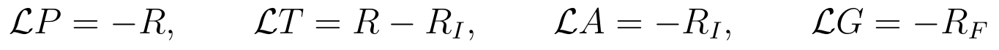
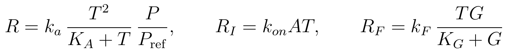
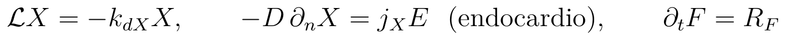
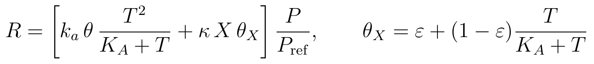
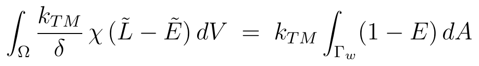
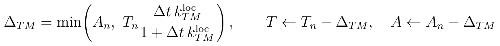
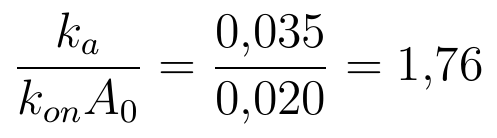

# Para qué es esta nota

Tenemos un modelo reducido de coagulación acoplado al flujo en la aurícula izquierda, PTAGX, y una batería de cinco tests de banco contra datos experimentales (E1 a E5) más la réplica del modelo 2D de Qureshi (Q1). Esta nota define el cambio **mínimo** que mejora a PTAGX de forma medible, explica por qué cada pieza está ahí, y deja escrito lo que todavía no sabemos.

La idea es que la leas con ojo crítico. No está cerrada: hay dos decisiones que tomé con criterio químico y sin datos que las respalden todavía, y están marcadas como tales. Si encontrás que alguna sobra, o que se puede ir más lejos con el mismo presupuesto de constantes, eso es exactamente lo que falta.

Al modelo que propongo lo llamo PTAGX-c, por el cofactor, que es el cambio principal.

# El modelo base

PTAGX transporta cuatro especies con L c = ∂ₜc + u·∇c − ∇·(D∇c):

{width=11.55cm}

con protrombina P, trombina T, antitrombina A y fibrinógeno G. Las tasas son

{width=11.21cm}

Además lleva una quinta especie transportada, X, y la fibrina F como campo nodal inmóvil:

{width=12.02cm}

y el término κX se suma a la amplificación en R.

Conviene aclarar algo que confunde a todo el mundo la primera vez, incluido a mí: **X es el factor Xa, no el zimógeno**. El flujo de pared j_X = Γ_FT·k_cat ya lleva adentro el factor tisular y el FVIIa, así que ninguno de los dos aparece como campo. Tampoco aparece el FX del plasma, y con razón: está a 170 nM y con la dosis medida de Kastrup pierde 0.8 nM en 1000 s, o sea medio por ciento. Llevarlo sería un campo y una constante de Michaelis para seguir una variable que no se mueve.

Lo que hace sólido a este modelo es la contabilidad. El paso nodal es Patankar-Euler modificado, así que para cualquier Δt se cumple P + T − A = P₀ − A₀ exactamente, todo queda no negativo, y como R′(0) = 0 una traza de trombina decae en vez de amplificarse. Nada de eso se toca en lo que sigue.

# Dónde falla el modelo base

Dos cosas, y las dos apuntan al mismo lugar.

**El trombograma (E1).** Con k_a = 0.035 y 5 pM de factor tisular, el pico de trombina da 238 nM contra un intervalo medido de 256–479 nM. Falla por poco, pero hay un síntoma peor: el pico casi no depende de la dosis de factor tisular. Bajando el factor tisular cinco veces, de 5 pM a 1 pM, el pico se mueve menos del 1 % (694 nM contra 701 nM, medido con k_a = 0.10). Un trombograma real sí responde a la dosis. Eso ya estaba anotado en el código como limitación conocida.

**El umbral de tamaño de parche (E4).** Kastrup midió que un parche de factor tisular de 50 µm o menos no coagula plasma en reposo, y uno de 100 µm o más coagula en menos de 3 minutos. El modelo base pone ese umbral entre 100 y 200 µm: se equivoca por un factor 2 en tamaño, y el parche de 200 µm tarda 4.6 minutos.

Los dos problemas están en la iniciación, no en la propagación. El test de propagación (E2, Thrombodynamics) lo pasa entero.

# El cambio principal: el cofactor Va

El Xa libre es un activador pésimo de protrombina. El complejo Xa·Va·fosfolípido, la protrombinasa, es órdenes de magnitud más rápido, y el Va lo produce la trombina misma. En PTAGX eso estaba escondido: κ = 3 s⁻¹ era un valor "parcialmente ensamblado", es decir, un parámetro libre disfrazado de constante física que promediaba los dos regímenes.

La separación es de una línea:

{width=11.72cm}

con κ = 10 s⁻¹, que es el giro medido de la protrombinasa ensamblada, y ε = 0.1, la actividad relativa sin cofactor. Con ε = 1 se recupera el modelo anterior bit a bit, y así está verificado.

Dos detalles de diseño que importan. Primero, θ_X reusa la misma semisaturación K_A de la otra realimentación, así que no entra una constante más. Segundo, el término sigue siendo cuadrático en T cerca del origen, con lo cual R′(0) = 0 se mantiene y el modelo no se vuelve inestable frente a ruido numérico.

Lo que cambia estructuralmente es que **la iniciación tiene que fabricar su propio cofactor antes de arrancar**, así que se convierte en un umbral; la onda que propaga, donde θ_X → 1, no se entera.

## Qué arregla

En el trombograma:

| caso (5 pM) | lag (min) | pico (nM) | ETP (nM·min) | en rango |
|---|---|---|---|---|
| intervalos medidos | 1.4–3.7 | 256–479 | 1414–2658 | |
| base (κ = 3, ε = 1) | 1.98 | 238 | 1576 | 2 de 3 |
| PTAGX-c | 1.61 | 311 | 1595 | **3 de 3** |

Y el pico vuelve a depender de la dosis: 218 nM a 1 pM contra 311 nM a 5 pM. Eso no se impuso por ningún lado.

En el umbral de tamaño, que es la prueba fuerte porque **no hay nada ajustado ahí** (la dosis es la densidad medida por Kastrup y ε se calibró en un trombograma 0D, sin espacio ni parches):

| parche | base | PTAGX-c | Kastrup |
|---|---|---|---|
| 25 µm | no inicia | no inicia | no coagula |
| 50 µm | no inicia | no inicia | no coagula |
| 100 µm | no inicia | 6.0 min | coagula < 3 min |
| 200 µm | 4.6 min | 1.7 min | coagula < 3 min |
| 400 µm | 2.6 min | 1.3 min | coagula < 3 min |
| velocidad del frente | 28.7 µm/min | 30.8 µm/min | 25–35 µm/min |

El umbral pasó de 100–200 µm a 50–100 µm, que es la ventana medida. El criterio formal del test sigue fallando porque el parche de 100 µm tarda 6 minutos y se piden menos de 3, pero eso es un error de tiempo en el caso justo del borde, no un error de umbral.

Para mí este es el argumento más fuerte de toda la nota: una constante ajustada en un ensayo 0D acertó después un umbral espacial de un experimento distinto.

Y E2 sigue pasando sus cinco criterios con el mismo k_a = 0.035, sin recalibrar nada: Tlag 1.00 min, V_i 55.4 µm/min, V_st 26.8 µm/min, CS30 1160 µm.

# El segundo cambio: E apaga la protección

La activación inflamatoria del endotelio no sube una ganancia genérica. Sube el factor tisular y baja la trombomodulina, el EPCR, el TFPI y el eNOS, todo junto y por la misma vía. En la aurícula esto está medido: el marcapaseo auricular rápido baja la expresión de trombomodulina y de TFPI en el endocardio de la aurícula izquierda y no en el ventrículo, localizada en las células endocárdicas (Yamashita 2003), y el factor tisular sube en el endotelio auricular en fibrilación no valvular (Nakamura 2003).

En PTAGX, E solo multiplicaba la fuente, j_X·E. Ahora hace las dos cosas que hace en la realidad: enciende el factor tisular y apaga la protección, con un sumidero k_TM(1−E)·T en la misma capa endocárdica.

Hay dos detalles que es fácil hacer mal.

**El primero es geométrico.** (1−Ẽ) no es una capa: vale aproximadamente 1 en toda la luz, así que usarla pondría trombomodulina en medio de la aurícula. La protección correcta es la *extensión* de (1−E), que por linealidad del problema de Poisson apantallado es L̃ − Ẽ, con L̃ la extensión del dato 1. Lleva su propia normalización de dosis,

{width=8.23cm}

**El segundo es de contabilidad.** La trombina que captura la trombomodulina se inactiva por antitrombina unas 20 veces más rápido, o sea sale del sistema como complejo serpina. En el paso nodal la cobra la antitrombina, uno a uno:

{width=13.68cm}

Así P + T − A sigue exacto para cualquier paso de tiempo, todo queda no negativo, y la protección queda **acotada por el pool de inhibidor**: la pared no puede proteger más de lo que hay disponible.

La constante no se ajusta. k_TM ≈ Γ_TM·k_on da 10⁻⁶ a 10⁻⁵ m/s para densidades de 10² a 10³ moléculas de trombomodulina por µm² y un k_on casi limitado por difusión. Usamos 10⁻⁵ m/s, que en la capa de 0.5 mm da una tasa de 0.02 s⁻¹, comparable a k_on·A₀ = 0.02 s⁻¹: duplica la inhibición junto a la pared sana, que es el orden correcto.

## Por qué esto reemplaza a σ

En una ronda anterior probamos otra forma de representar el daño de pared: una amplificación superficial σ que subía la ganancia θ en la capa activada, calibrada para que el modelo iniciara bajo flujo (E5). Funcionaba para eso y rompía todo lo demás. La comparación deja claro por qué:

| | σ (amplificación) | k_TM(1−E) (protección) |
|---|---|---|
| signo | aditiva a la ganancia | sustractiva |
| cota | ninguna | el pool de antitrombina |
| dónde actúa | **toda** superficie reactiva, incluido el activador de vidrio de un ensayo | solo donde hay endotelio |
| contraparte medida | ninguna directa | trombomodulina del endocardio |
| efecto en los tests | rompe E2 (Tlag 0.33 contra 0.6–1.5 medido), E3 y E4 (todos los parches encienden) | no toca ningún test de banco |

La tercera fila es la que decide. σ se calibró en E5 y después amplificó el activador de E2 y los parches de lípido de E4, que no son endotelio. La pérdida de trombomodulina, por construcción, no puede hacer eso.

**Importante para interpretar los resultados:** este cambio no mejora ningún número de los tests de banco, y no puede, porque ninguno tiene endotelio. Está acá por la química y porque saca una constante ajustada. Su efecto real hay que medirlo en la aurícula, y eso todavía no se hizo.

# Lo que se dejó afuera

**El monómero de fibrina.** Químicamente el reparto correcto son tres especies: fibrinógeno soluble y repuesto por el flujo, monómero soluble de vida corta, polímero anclado. Lo implementé (L f = R_F − R_pol, ∂ₜF = R_pol, R_pol = k_pol·f(f+F) con k_pol de Weisel y Nagaswami) y **no cambia nada en ningún test**: E2 da 1.00 / 55.5 / 26.8 / 1160 con monómero contra 1.00 / 55.4 / 26.8 / 1160 sin él. La razón es que a µM el monómero polimeriza en un segundo, así que gela donde se cortó. Solo actúa con flujo, a nM, donde la vida del monómero es 1/(k_pol·f) ≈ 100 s y la corriente se lo lleva antes de que gele.

Cuesta un campo transportado, un 14 % de tiempo de cómputo medido, y una constante más. En el modelo mínimo va apagado. Está en el código con bandera y la pregunta de si vale la pena quedó abierta más abajo.

**El lazo intrínseco con retardo (φ).** La trombina activa el FXI, cuya tenasa produce más Xa después de un retardo. Lo implementé como una redistribución de la realimentación en el tiempo que no cambia la ganancia. En E2, φ = 0.3 saca a V_i del rango por un 2 % y φ = 0.7 saca también a V_st y CS30. Descartado, aunque el término quedó en el código con default 0.

**El eNOS.** Actúa sobre plaquetas, y PTAGX no las tiene por construcción. Si algún día se enciende el módulo de plaquetas de PTAGP, su lugar natural es el estímulo de activación, no la ecuación de E.

**Dinámica propia de E.** Lo natural sería dE/dt = (E_∞ − E)/τ_E. Pero τ_E es transcripción más recambio proteico: Yamashita mide el efecto a las 8 horas, y una corrida auricular es de 60 segundos. Durante toda la simulación E está congelado. Conviene declarar explícitamente la separación de escalas: el estado inflamatorio del endocardio es un dato del paciente, fijado por su historia de cizalle, no una variable del minuto que se simula.

# Las cuentas

| | base | **PTAGX-c** | versión completa |
|---|---|---|---|
| especies transportadas | 6 | **6** | 7 |
| constantes ajustadas | k_a, κ | **k_a, ε** | k_a, ε |
| de literatura o derivadas | — | **κ, k_TM** | κ, k_TM, k_pol |
| tiempo de cómputo | referencia | **igual** | +14 % |
| E1 / E2 / E3 / E4 / E5 | 2·5·0·2·2 | **3·5·0·2·2** | 3·5·0·2·2 |

El punto que me parece más importante de toda la tabla: **el número de constantes ajustadas no subió**. κ = 3 ya era libre, solo que no lo parecía. Ahora κ está clavado por la literatura y ε toma esa libertad, pero con identidad química propia y con un rango de validez amplio: los tres intervalos de E1 se cumplen para ε entre 0.03 y 0.3, y para k_a entre 0.03 y 0.05.

Y hay un costo que no está en la tabla y conviene decirlo: **E1 dejó de ser predicción**, porque ε se ajusta ahí. Antes había cuatro predicciones (E1, E3, E4, E5) y ahora hay tres. Me gasté un test para pasar ese test. Lo que lo justifica es que a cambio E4 acertó el umbral y el pico recuperó su dependencia con la dosis, que no era un criterio de ningún test.

También verificamos que el cambio es limpio: con `-ptag_eps_x 1 -ptag_kappa_x 3 -ptag_fibrin_monomer false -ptag_k_tm 0` la aurícula reproduce **bit a bit** una corrida Q1 guardada, 160 de 160 filas, diferencia relativa máxima 0.

# Lo que no se arregló

## E3, la respuesta a anticoagulantes

Un DOAC se modela bajando κ (anti-Xa) o subiendo A₀ (anti-IIa), y el criterio es igualar el cociente pico/valle del retardo medido y después mirar la velocidad y el tamaño del coágulo.

| perturbación | Tlag/control | V_i/control | CS30/control |
|---|---|---|---|
| κ×0.9 | 1.08 | 0.97 | 1.00 |
| κ×0.75 | 1.17 | 0.90 | 0.98 |
| κ×0.5 | 1.42 | 0.74 | 0.94 |
| κ y k_a ×0.94 | 1.00 | 0.92 | 0.73 |
| **medido, rivaroxabán** | **1.67** | **0.86** | **0.73** |
| **medido, apixabán** | **1.18** | **0.95** | **0.82** |

Bajando solo κ, el tamaño del coágulo casi no se mueve; bajando κ y k_a juntos, el tamaño acierta pero el retardo no se mueve. El modelo iguala la respuesta del coágulo o la del retardo, no las dos.

La razón es estructural. El Xa solo vive a unos 68 µm del activador (√(D/k_dX)), así que bajar κ retrasa el arranque pero no toca la onda; y la onda la mueve k_a, que un anti-Xa no toca en esta parametrización. En la realidad sí lo toca, porque la realimentación de la trombina pasa por FXI → FIXa → FXa. Falta ese lazo.

Hay un número que conviene tener presente: la supercriticidad del lazo de volumen frente a la inhibición es

{width=4.2cm}

apenas por encima de 1, y k_a no se puede subir porque lo fijan V_st y CS30 de E2 (con k_a = 0.04 el coágulo a 30 minutos se va a 1780 µm contra 800–1200 medidos). Un solo lazo de volumen está haciendo de motor de la onda y de limitador del tamaño final a la vez.

Vale aclarar que la onda **sí es autónoma**, que es como debe ser. Lo medimos directo, misma cinética y dosis del activador variando ocho veces:

| j_X/j_X0 | Tlag (min) | V_i (µm/min) | V_st (µm/min) | CS30 (µm) |
|---|---|---|---|---|
| 0.5 | 1.42 | 40.9 | 30.0 | 1085 |
| 1 | 1.00 | 55.4 | 26.8 | 1160 |
| 2 | 0.67 | 62.3 | 25.1 | 1205 |
| 4 | 0.50 | 66.3 | 24.1 | 1235 |

CS30 se mueve un 6 % mientras la dosis cambia ocho veces: el coágulo final no se acuerda del activador, como en el ensayo real (Dashkevich 2012). Lo que sí depende de la dosis es el retardo y V_i, y V_i porque se mide entre 2 y 6 minutos *después* del retardo, cuando el frente todavía está cerca del activador.

## E5, la iniciación bajo flujo

Shen midió que un parche de 200 µm inicia a 5 s⁻¹ en unos 210 s y no inicia a 40 s⁻¹ en 300 s. PTAGX-c acierta los dos casos negativos y falla los dos positivos.

El problema es que ese trabajo **no publica la densidad de factor tisular de sus parches**, así que lo que el experimento restringe no es la cinética sino el producto dosis por cinética. Barrimos la dosis:

| j_X (mol m⁻²s⁻¹) | × Kastrup | inicia a 5 s⁻¹ | inicia a 40 s⁻¹ |
|---|---|---|---|
| 4.0×10⁻¹³ | 1 | no | no |
| 4.0×10⁻¹² | 10 | no | no |
| **1.2×10⁻¹¹** | **30** | **10 s** | no |
| 4.0×10⁻¹¹ | 100 | 4 s | 10 s |

Existe una dosis que reproduce el umbral de cizalle completo, o sea el mecanismo está. Pero es 30 veces la única densidad medida, y además inicia en 10 segundos cuando lo medido son 210: el modelo pasa de "nunca" a "de inmediato" sin pasar por el régimen lento.

Eso tiene un diagnóstico claro. Los 210 s de Shen los fija la acumulación de complejos **unidos a la superficie** del parche, que tienen su propio tiempo de residencia mientras el flujo barre el plasma. θ_X es un sustituto de volumen de ese hecho de superficie: captura que hace falta un cofactor, pero no que el cofactor se queda pegado. Por eso el arranque es un interruptor y no una rampa.

Para el paper la frase honesta es que el modelo reproduce la existencia del umbral de cizalle pero necesita 30 veces la dosis medida y no reproduce el tiempo de iniciación.

# Preguntas abiertas

Estas son las que dejaría para trabajar, más o menos en orden de lo que rinde por hora invertida.

**1. ¿El monómero de fibrina hace algo en la aurícula?** Es la decisión que tomé con criterio químico y sin datos. Sin monómero, el modelo gela donde la trombina corta, incluso en el chorro de las venas pulmonares, y eso parece un artefacto. Correr Q1 con `ptagx` y con `-ptag_fibrin_monomer false` y comparar dónde se deposita la fibrina. Si no cambia, sacarlo y quedarse en seis especies; si cambia, hay que defenderlo y entonces la versión completa es la buena.

**2. ¿Cuánto importa k_TM?** La derivación da un rango de un orden de magnitud (10⁻⁶ a 10⁻⁵ m/s) y elegimos el extremo alto. Barrer ese rango en Q1 y ver si el contraste entre pared sana y orejuela cambia cualitativamente o solo de grado. Si cambia cualitativamente, hace falta pinchar mejor esa constante.

**3. ¿Se puede sacar ε de otro lado y devolverle a E1 su condición de predicción?** ε lumpea la fracción de FVa disponible sin realimentación por la amplificación del cofactor. Si se encuentra una medición independiente de cualquiera de las dos cosas, E1 vuelve a ser test. Vale la pena buscarlo en la literatura de protrombinasa.

**4. ¿Cuál es el mínimo de especies de superficie que arregla E5?** Dos campos de superficie (Xa unido, Va unido) con sus tasas de adsorción y desorción son cuatro constantes más. ¿Alcanza con uno solo, un "sitio activo ocupado" con una tasa de recambio? Si alcanza, es una constante y arregla el test que hoy está peor.

**5. El lazo FXI con ganancia propia.** Es lo que falta para E3, pero no es gratis: agrega ganancia de volumen y por lo tanto reabre la calibración de k_a en E2 entera. Vale la pena hacer el cálculo de si existe un par (k_a, ganancia del lazo) que deje E2 donde está y mueva E3. Si no existe, eso también es un resultado.

**6. ¿Se puede encontrar la densidad de FT de Shen?** Los 30× de E5 cambian completamente de significado según si los parches de Shen eran o no comparables a los de Kastrup. Vale un rato de búsqueda en los suplementos y en los trabajos que los citan.

**7. Resolución de la capa de Lévêque en la aurícula.** El espesor de la capa de concentración es δ = (D·L_p/γ)^(1/3), que a los cizalles de la orejuela da unos 105 µm, comparable al tamaño de malla de 0.15 mm. O sea el modelo resuelve la capa justo donde predice trombo y no la resuelve donde no predice nada. Convendría un estudio de convergencia de malla para fijar hasta qué cizalle el resultado es confiable.

**8. ¿El parche de 100 µm de E4 es un problema de física o de criterio?** Tarda 6 minutos y se piden menos de 3. Es el caso del borde y es el único que falla. Ver si con una malla más fina o un paso de tiempo menor se acerca, antes de concluir que es el modelo.

# Cómo correrlo

Compilar los dos ejecutables:

```
cd build && cmake . && make PTAGXBench LeftAtrium2DPTAGX
cd ../examples/Heart/Thrombosis/TestPTAGX
```

Los tests, que imprimen el veredicto de cada uno apenas termina y lo guardan en `results/verdict.md`:

```
python3 run_all.py --jobs 8                 # E1 a E5 y Q1
python3 run_all.py --skip-q1 --jobs 8       # solo los de banco
```

Para el modelo mínimo de esta nota, apagar el monómero en el diccionario `PTAGX` de `ptagx_common.py` (`pg_fibrin_monomer=False`) o pasar `-ptag_fibrin_monomer false` en la aurícula. Hoy el código viene con el monómero encendido, porque la pregunta 1 está abierta.

Para volver al modelo base y comparar: `-ptag_eps_x 1 -ptag_kappa_x 3 -ptag_fibrin_monomer false -ptag_k_tm 0`.

Los diagnósticos sueltos que se usaron acá:

```
python3 E2_Thrombodynamics/source_vs_wave.py   # ¿onda autónoma o frente empujado por la fuente?
python3 E5_ShearThreshold/calibrate_jx.py      # dosis de FT que reproduce el umbral de cizalle
python3 E4_PatchThreshold/scan_sigma.py        # (histórico) sigma que tolera el parche de 50 µm
```

# Referencias

Kastrup CJ, Runyon MK, Shen F, Ismagilov RF. Modular chemical mechanism predicts spatiotemporal dynamics of initiation in the complex network of hemostasis. *PNAS* 103 (2006) 15747–15752.

Kastrup CJ, Shen F, Runyon MK, Ismagilov RF. Characterization of the threshold response of initiation of blood clotting to stimulus patch size. *Biophys J* 93 (2007) 2969–2977.

Shen F, Kastrup CJ, Liu Y, Ismagilov RF. Threshold response of initiation of blood coagulation by tissue factor in patterned microfluidic capillaries is controlled by shear rate. *Arterioscler Thromb Vasc Biol* 28 (2008) 2035–2041, y su información suplementaria.

Dashkevich NM, et al. Thrombin activity propagates in space during blood coagulation as an excitation wave. *Biophys J* 103 (2012) 2233–2240.

Gebekova ZA, et al. Thrombodynamics test in assessing the risk of thrombus formation in patients with atrial fibrillation taking direct oral anticoagulants. *Ration Pharmacother Cardiol* 18 (2022) 544–552.

ELSA-Brasil. Performance and reference intervals of thrombin generation test. *Sao Paulo Med J* (2022).

Hemker HC, et al. Calibrated automated thrombin generation measurement in clotting plasma. *Pathophysiol Haemost Thromb* 33 (2003) 4–15.

Butenas S, van 't Veer C, Mann KG. "Normal" thrombin generation. *Blood* 94 (1999) 2169–2178.

Colace TV, Muthard RW, Diamond SL. Thrombus growth and embolism on tissue factor-bearing collagen surfaces under flow. *Arterioscler Thromb Vasc Biol* 32 (2012) 1466–1476.

Weisel JW, Nagaswami C. Computer modeling of fibrin polymerization kinetics correlated with electron microscope and turbidity observations. *Biophys J* 63 (1992) 111–128.

Yamashita T, et al. Thrombomodulin and tissue factor pathway inhibitor in endocardium of rapidly paced rat atria. *Circulation* 108 (2003) 2450–2452.

Nakamura Y, et al. Tissue factor expression in atrial endothelia associated with nonvalvular atrial fibrillation: possible involvement in intracardiac thrombogenesis. *Thromb Res* 111 (2003) 137–142.

Qureshi A, et al. Modelling left atrial flow and blood coagulation for risk of thrombus formation in atrial fibrillation. *Computing in Cardiology* 48 (2021).
